<!-- _paginate: false -->

# Time Series Bootcamp · Day 2
## Deep learning, foundation models and advanced topics

Weekly retail sales · 18,692 products · one supermarket
`neuralforecast` · `statsforecast` · `mlforecast` · `timecopilot` · `polars`

<!--
Welcome back. Yesterday: baselines, evaluation, gradient boosting. Today: neural global models, tuning, covariates, foundation models, hierarchy, uncertainty, and how to pick and combine models. Same data, same split, same leaderboard.
-->

---

<!-- _class: dense -->

# Today

| Time | Segment | Type | Notebook |
|---|---|---|---|
| 0:00 | Recap and handoff: Day 1 leaderboard | talk | `00` |
| 0:10 | Deep learning for global modelling | talk | |
| 0:25 | ML vs NNs: transforms, features, parameters, evaluation, losses | talk | |
| 0:45 | Default training with GFMs | **lab** | `01` |
| 1:05 | Hyperparameter optimisation | **lab** | `02` |
| 1:35 | *Break* | | |
| 1:50 | Exogenous variables and responsiveness | **lab** | `03` |
| 2:20 | Foundation models | talk | |
| 2:40 | Foundation models: tune or not? | **lab** | `04` |
| 3:10 | Hierarchy and coherence | **lab** | `05` |
| 3:30 | Uncertainty: scoring rules and conformal | talk + demo | `06` |
| 3:50 | Model selection and ensembling | **lab** | `07` |
| 4:10 | Final standings | | `07` |

<!--
255 minutes. Labs are designed so the core cells run in the slot on a laptop CPU with the default 2,000-series sample. Anyone with a GPU can set BOOTCAMP_N_SERIES=0 and BOOTCAMP_MAX_STEPS=1500.
-->

---

# Recap: the rules of the game

```
2023-07-05 ────────── train ────────── 2025-04-16 ─── test (14 weeks) ─── 2025-07-16
                               valid (last 14 train weeks) ┘
```

- **Target**: weekly `sales_units` per item · **horizon** 14 weeks · weeks start on **Wednesday** (`W-WED`)
- **Score**: mean **RMSSE**, scaled by each series' in-sample 52-week seasonal-naive error
- Also: median RMSSE, MASE, sMAPE, **WAPE** (volume-weighted), **fit time**
- Same stratified 2,000-series sample in every lab (`bootcamp.load_panel()`)
- Every lab ends with `bc.record(...)` → one row per model in `results/day2/leaderboard.csv`

<!--
Run notebook 00 live. It rebuilds the Day 1 references (Naive, SeasonalNaive, AutoETS, LightGBM) so the leaderboard is never empty. If participants kept results/day1/leaderboard.csv, it is shown too.
-->

---

<!-- _class: intuition -->

# Reading RMSSE in one picture

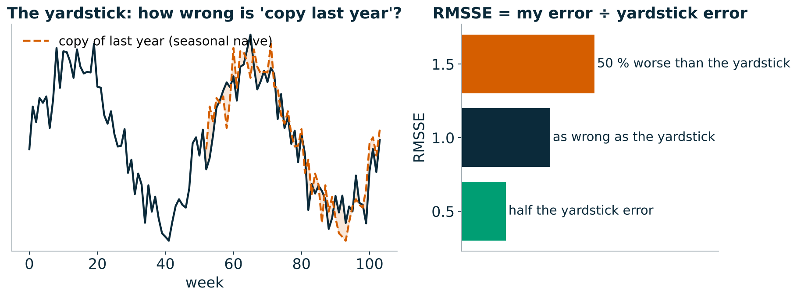

- **The yardstick** is "copy the same week last year", measured on each item's own history. RMSSE = my error ÷ the yardstick's error
- **0.6** means 40 % smaller errors than the yardstick. **Scale-free**: a 600-unit item and a 150k-unit item count the same
- **Above 1 is normal out of sample**: the yardstick was measured on the past, our forecast is judged on a future it has not seen

<!--
Intuition first, formula never. Ask the room: if RMSSE were 1.0 for every item, what would that mean? (We are exactly as good on the future as copying last year was on the past.) Make sure everyone can read a leaderboard number before the labs start.
-->

---

# Recap: Day 1 leaderboard

<div class="cols">
<div>

**What we learned**
- Seasonal naive is hard to beat on slow movers
- A *global* GBDT with lags, calendar and price/promo features was the strongest model
- Mean RMSSE treats every series equally; class **J** (slow movers) is ~2/3 of series

</div>
<div>

**Open questions for today**
- Is the GBDT strong because it is **global**, or because it sees **covariates**?
- Can a neural net learn the features we hand-built?
- What does it cost?
- Does any of it **respond to price** the right way?

</div>
</div>

<!--
Show the leaderboard printed at the end of notebook 00. Ask the room the two handoff questions at the end of the notebook.
-->

---

<!-- _class: result -->

# Day 1 in one picture

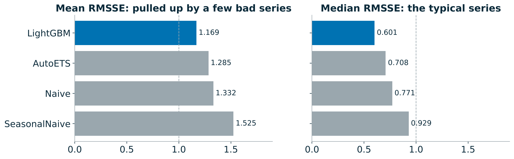

- **Last week beats last year** (Naive 1.33 vs SeasonalNaive 1.52): with under two years of history and promotions that move around the calendar, "the same week last year" is a weak guide
- **Mean 1.17, median 0.60**: the typical item is forecast well; a minority of erratic, promo-driven items drags the mean up. Keep both numbers in view all day

<!--
Numbers are from the reference run (2,000-series sample). Your room's numbers will be close but not identical. The mean/median gap comes back in lab 07, where 22 % of series turn out to make half of the mean.
-->

---

<!-- _class: dense -->

# Deep learning for global modelling

**Global model** = one set of parameters shared by all series, trained on windows sampled from every series.

- Learns patterns that recur **across** series (promo spikes, seasonal shapes, launch curves)
- Works for **short and new** series that a local model cannot fit
- Training cost scales with **windows sampled**, not with number of series × models

The three architectures we use today, all in `neuralforecast`:

| | N-BEATS | N-HiTS | TFT |
|---|---|---|---|
| Core | stacked MLP blocks, backcast/forecast residuals | N-BEATS + multi-rate pooling + interpolation | LSTM encoder + attention + variable selection |
| Decomposition | optional (trend/seasonality basis) | implicit, by frequency band | none |
| Covariates | future + static (NBEATSx) | future + historic + static | future + historic + static, gated |
| Speed | fast | fastest | slow |

<!--
15-minute segment. Emphasise: these are all window-based global MLPs or seq2seq models, not "magic". N-BEATS: Oreshkin et al. 2020, won M4 among pure DL. N-HiTS: Challu et al. 2023, cheaper and better at long horizons. TFT: Lim et al. 2021, interpretability via variable selection weights and attention.
-->

---

<!-- _class: intuition -->

# Why one model for 2,000 series works

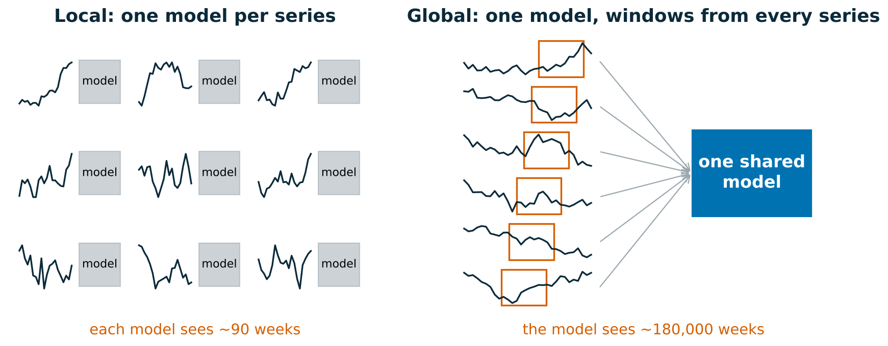

- A **local** model is a shop assistant who has only ever watched one shelf. A **global** model has watched the whole store, so it recognises a promo spike it has seen thousands of times, even on a brand-new item
- The catch: it learns **typical** behaviour. Per-window scaling and covariates are how it adapts to each item

<!--
This is the single most important idea of the morning. The data per local model is ~90 weeks; the global model sees about 180,000 weeks. Everything else (N-BEATS, N-HiTS, TFT, LightGBM with lags) is a different way of learning from that pooled data.
-->

---

# N-BEATS in one slide

- Input: the last `input_size` values · output: the next `h`
- Each **block**: MLP → coefficients θ → **backcast** (explains the input) and **forecast**
- Next block sees the **residual** of the input: doubly residual stacking
- **Generic** stack: θ maps through a learned linear basis
- **Interpretable** stack: θ are coefficients of a **polynomial trend** and **Fourier seasonality** basis
  → the forecast is a sum of trend + seasonality components you can plot

**N-HiTS** adds max-pooling on the input (each stack looks at a different time resolution) and predicts a few points that are interpolated to the horizon: fewer parameters, faster, smoother.

<!--
Lab 01 trains both generic and interpretable N-BEATS so the room can see whether the decomposition prior helps on two years of weekly data. In the reference run it made no difference to accuracy (1.216 vs 1.216): there are only ~1.8 seasonal cycles to learn from.
-->

---

<!-- _class: intuition -->

# N-BEATS as a relay race

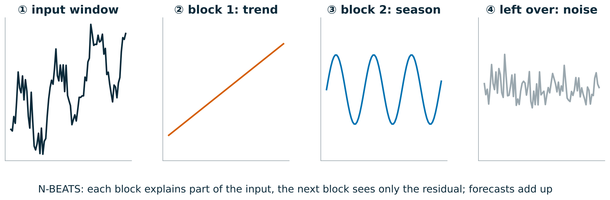

- Each block is a runner: it explains the part of the input it can, **subtracts it**, and hands the rest to the next runner. The forecast is the sum of what every runner carried
- **Interpretable** N-BEATS forces runner 1 to be a trend and runner 2 a season, so you can plot each piece
- **N-HiTS** runs the same relay, but runners look at blurred (pooled) inputs, from coarse to fine: cheaper and smoother

<!--
If people remember one picture of N-BEATS, make it this one. Residual stacking is just "explain, subtract, pass on". The interpretable variant is the same machine with a constraint on what each block may output.
-->

---

# Temporal Fusion Transformer in one slide

- **Variable selection networks** weigh each covariate per time step
- **Static covariate encoders** condition everything on item attributes
- LSTM **encoder–decoder** for local patterns, **multi-head attention** for long-range ones
- Natively outputs **quantiles**
- Interpretable: variable importances and attention patterns

Cost: an order of magnitude slower to train than N-HiTS on the same data; benefit grows with **rich, informative covariates** and long histories.

<!--
Mention that TFT is in lab 01 behind RUN_TFT=False because on a CPU it does not fit in the 20-minute slot.
-->

---

<!-- _class: dense -->

# Neural global models vs GBDTs

| | GBDT (LightGBM via `mlforecast`) | Neural GFM (`neuralforecast`) |
|---|---|---|
| Features | **you build them**: lags, rolling stats, calendar | learned from the raw window (+ covariates) |
| Multi-step | recursive or one model per step | direct: whole horizon at once |
| Scaling | target transforms per series | per-window scaler inside the model |
| Training cost | minutes on CPU | minutes to hours, GPU preferred |
| Inference cost | cheap, CPU | cheap per batch, GPU helps |
| Tuning burden | moderate, robust defaults | sensitive: lookback, lr, steps |
| Monotone constraints | **built in** | not available |
| Probabilistic | quantile objective or conformal | quantile / distribution losses |

**Evidence**: M5 (Walmart) was won by LightGBM ensembles; N-BEATS / N-HiTS shine on long, regular series and many horizons.

<!--
Costs to call out: GPU hours, engineering time for feature pipelines, MLOps (two very different stacks), and serving latency. For a weekly batch job of 20k series, both are cheap to serve; the real cost is training and tuning iterations.
-->

---

<!-- _class: dense -->

# ML vs NNs (1/3): transforms and features

**Transformations**
- GBDTs: transform the **target** per series (`LocalStandardScaler`, `log1p`, differences) and invert after prediction
- NNs: scale **each input window** (`scaler_type="robust" | "standard" | "revin"`); one global scaling fails when series differ by 5 orders of magnitude (class A ≈ 150k units/week, class J ≈ 600)
- Zero-heavy series: log transforms need an offset; robust scaling needs non-zero IQR

**Feature engineering**
- GBDTs need **lags, rolling means, calendar, price features** spelled out
- NNs learn lags from the window but still need **covariates** (price, promo) and benefit from **calendar** features at weekly resolution
- Hierarchy ids: categorical features for GBDTs; for NNs use embeddings or numeric **static covariates** (log mean sales, share of zero weeks, share of promo weeks). A raw id fed as a number is meaningless

<!--
20-minute segment total for the three ML vs NN slides. Live: show `bootcamp._add_price_features` – these relative price features are shared by LightGBM and NHITSx in lab 03.
-->

---

<!-- _class: intuition -->

# Scaling: compare shapes, not sizes

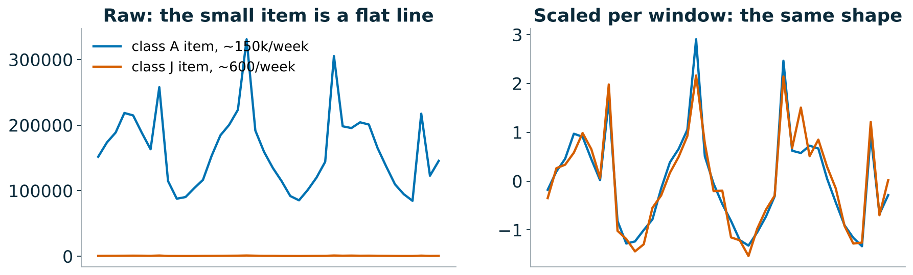

- Unscaled, a class J item (~600/week) is a flat line next to a class A item (~150k/week), and the network learns only the big ones
- Scaled per window, both show the **same shape**: what the global model actually needs to learn. The forecast is scaled back afterwards
- Same reason covariates must be **relative** (price index, discount depth): a raw price of 0.99 vs 39.99 says nothing about a discount

<!--
This is why NHITSx broke during preparation when we fed raw sale prices: the network saw "expensive item" instead of "cheaper than usual". Lab 03 uses scale-free covariates and scaler_type="standard".
-->

---

# ML vs NNs (2/3): parameters and evaluation

**What you tune**

| GBDT | NN |
|---|---|
| `num_leaves`, `learning_rate`, `n_estimators` | `input_size` (lookback), `learning_rate`, `max_steps` |
| `min_data_in_leaf`, regularisation | `scaler_type`, `loss`, `batch_size` |
| which lags / windows | architecture size (rarely matters) |

**How you evaluate**
- Both: temporal holdout + **rolling-origin cross-validation**, never random K-fold
- NNs: **validation window inside training** for early stopping (`val_size=h`)
- NNs are **stochastic**: re-run with 3 seeds before believing a 1 % difference
- Report **fit time** next to accuracy

<!--
Seed variance is the thing most people skip. In lab 01 the two CV folds give the noise floor.
-->

---

# ML vs NNs (3/3): loss functions

| Loss | Estimates | Use when |
|---|---|---|
| MSE | mean | metric is RMSE/RMSSE, few outliers |
| MAE | median | metric is MAE/MASE, robust to spikes; **median of intermittent series can be 0** |
| Huber | between the two | promo spikes + RMSE-type metric |
| Poisson / Tweedie | mean of counts | intermittent, non-negative demand (GBDT objective; `DistributionLoss` in NNs) |
| Quantile / MQLoss | quantiles | intervals, asymmetric costs (stock-outs vs waste) |

**Match the loss to the metric** and to the decision. Training on MAE and scoring on RMSSE is a common silent mismatch.

<!--
Lab 02 includes loss in the sensitivity sweep so participants can see how much it matters on this data.
-->

---

<!-- _class: intuition -->

# The loss decides which number you get

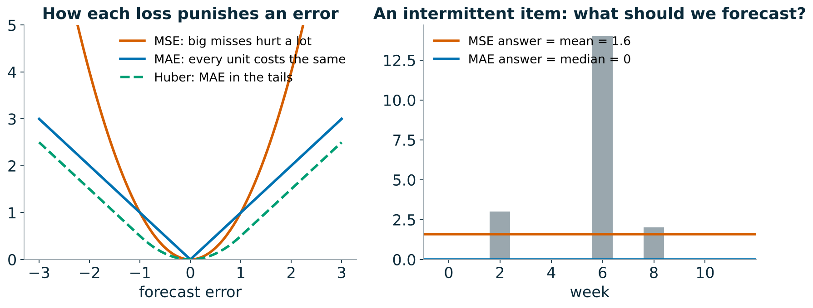

- Train on **MSE** and the model aims for the **mean**; train on **MAE** and it aims for the **median**
- For an item that sells nothing most weeks, the median is **0**: an MAE model may happily forecast zero, and stock nothing
- Pick the loss for the **decision**: the mean for volume planning, a high quantile for avoiding stock-outs

<!--
Ask: which number do you want for a slow mover that sells 0, 0, 3, 0, 0, 0, 14? The answer depends on what you do with it, which is the point. Lab 02 shows the loss is the most influential knob on this data.
-->

---

<!-- _class: lab -->

# Default training with GFMs · `01` (20 min)

1. **Wrangle**: polars panel → pandas long format; check gaps, duplicates, weekday, scale spread
2. **Split**: train / valid (early stopping) / test; 2-fold rolling-origin CV on train for the noise floor
3. **Train with defaults**: NHITS · N-BEATS generic · N-BEATS interpretable (trend + seasonality) · DLinear (moving-average decomposition) · TFT optional
4. `bc.record(...)` → leaderboard

**Discuss**: did decomposition help? How does fit time compare with LightGBM?

<!--
Expected result on CPU with defaults (500 steps): neural models land between LightGBM (1.17) and AutoETS (1.29); NHITS at about 1.19. The results slide that follows has the reference numbers and how to read them.
-->

---

<!-- _class: result -->

# Lab 01: what we found

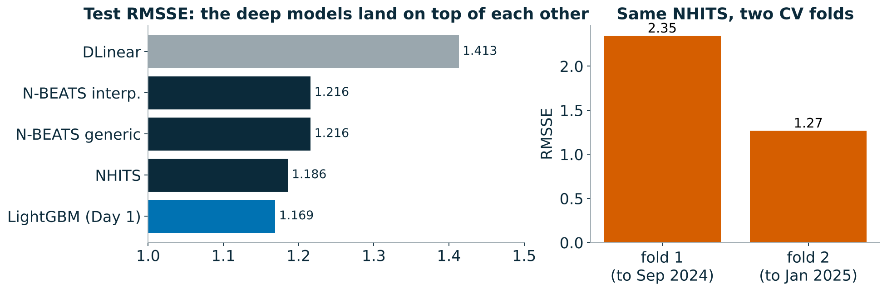

- **The deep models land on top of each other** (1.19–1.22) and next to LightGBM (1.17). DLinear, a linear model, is clearly worse: weekly retail is not linear
- **Interpretable = generic** (1.216 vs 1.216): the trend/season prior costs nothing and buys plots, but 1.8 yearly cycles are too few to learn a season from
- **The noise floor**: the same NHITS scores 2.35 or 1.27 depending on which 14 weeks it is tested on. A 0.03 gap between models on one window may well flip on the next
- **Cost**: 20–30 s per neural fit vs 1.6 s for LightGBM

<!--
Reference run, CPU, 500 steps. Turn the room's attention to the fold bars: the period you test on moves the score far more than the model choice does. This sets up lab 02: if a tuning gain is smaller than this, it is not a gain.
-->

---

<!-- _class: lab -->

# Hyperparameter optimisation · `02` (30 min)

**Part 1: one-at-a-time sensitivity** (scored on the validation window, not the test)
- vary `input_size`, `learning_rate`, `scaler_type`, `loss`, `max_steps`, `mlp_units`, `n_blocks`
- plot the RMSSE **spread** per parameter → that ranking is your tuning budget

**Part 2: Optuna TPE search** with `AutoNHITS` over the parameters that mattered, fANOVA importances, refit, score

| Usually worth tuning | Usually not |
|---|---|
| lookback, learning rate, steps, scaler, loss | layer width, number of blocks, activation |

<!--
Ask: compare each spread to the CV fold-to-fold spread from lab 01. Anything smaller is noise. If the room is short on time, cut the GRID to input_size, learning_rate and mlp_units.
-->

---

<!-- _class: result -->

# Lab 02: what we found

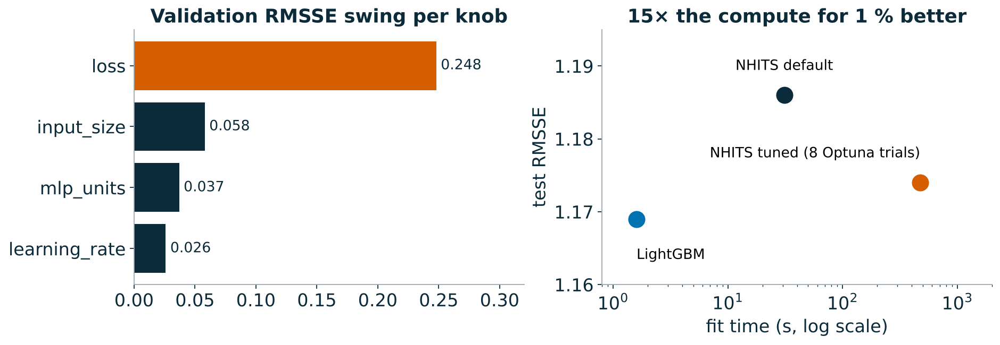

- **The loss was the big knob**: MSE 1.51 vs MAE 1.26 on validation. MSE chases the promo spikes and overshoots every normal week
- Lookback, width and learning rate each moved the score by **less than 0.06**: small next to how much the score moves between test periods
- **Optuna**: 8 trials, 474 s, test RMSSE 1.186 → 1.174. That is **15× the compute for 1 %**, and LightGBM is still ahead
- Rule of thumb: get the **loss** and the **scaling** right, then stop tuning

<!--
fANOVA on the Optuna study put 97 % of the importance on the learning rate, but only within the narrow range we searched; the one-at-a-time sweep is the more honest picture of "what is worth tuning" here.
-->

---

<!-- _paginate: false -->

# Break · 15 min

---

<!-- _class: lab -->

# Exogenous variables and responsiveness · `03` (30 min)

| Covariate type | Example | Known in the future? |
|---|---|---|
| **future** (`futr_exog_list`) | planned price, promo flag, discount depth | yes, by plan |
| **historic** (`hist_exog_list`) | competitor price, footfall | no |
| **static** (`stat_exog_list`) | log mean sales, share of zero / promo weeks | constant |

**Response-curve checks**: shift price −25 % … +25 %, switch promos on/off, re-forecast.
- Price curve should slope **down**; promo lift should be **positive** and close to the empirical lift
- Arc elasticity per series; share of **perverse** (> 0) and **flat** responses
- LightGBM with `monotone_constraints` forces the sign; a NN cannot
- For a global NN, covariates must be **scale-free** (`price_index`, `discount_depth`), not raw prices

<!--
Key message: an accurate forecast that does not respond to price is useless for promo planning. Confounding: retailers cut prices when they expect high demand, so naive models can learn price↑ → sales↑.
-->

---

<!-- _class: intuition -->

# Accuracy vs responsiveness

<div class="cols">
<div>

- **Accuracy** asks: did you predict what happened?
- **Responsiveness** asks: if we changed the price, would you predict the right thing?
- A model can score well and still answer "what if?" wrongly: it may have learned **when** promos happen, not **what they do**
- **Confounding**: retailers discount when they expect demand to be high, so the data alone can suggest "cheaper → fewer sales"

</div>
<div>

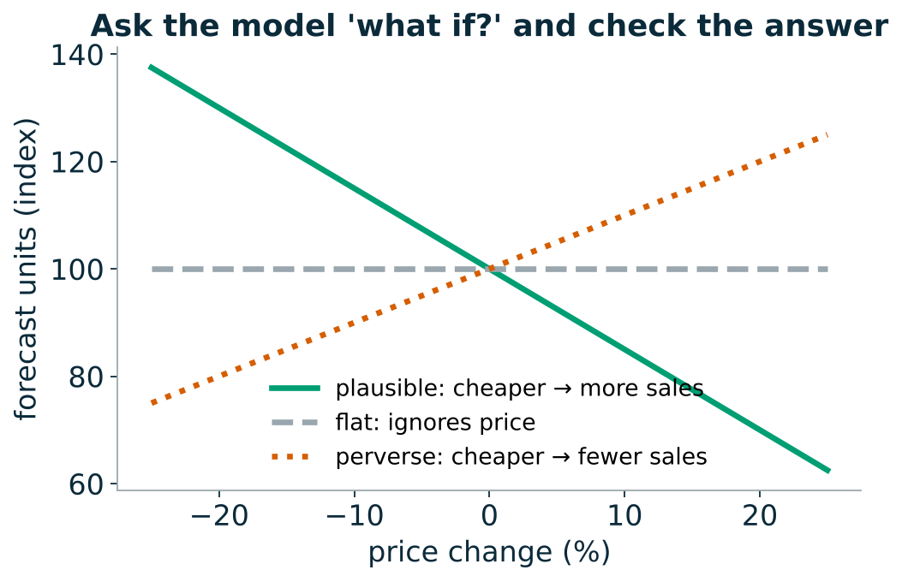

</div>
</div>

<!--
Analogy: ice-cream sales and sunburn rise together; banning ice cream does not prevent sunburn. The model sees promotions and high sales together but cannot tell which way the arrow points without a check like the response curves in this lab.
-->

---

<!-- _class: result -->

# Lab 03: what we found

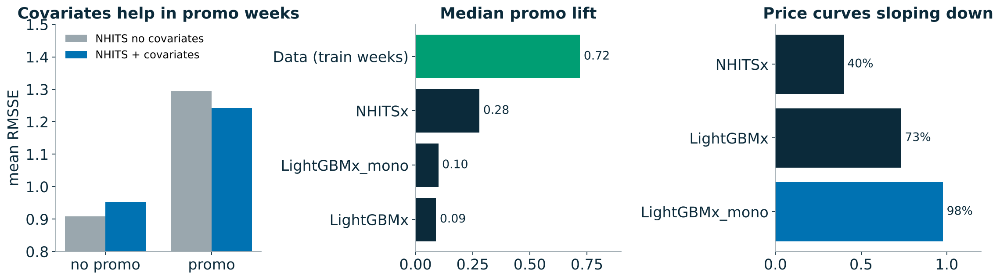

- **Covariates help where they carry information**: in promo weeks NHITS improves 1.29 → 1.24; in ordinary weeks it gets slightly worse (0.91 → 0.95)
- **Direction mostly right**: fewer than 2 % of price curves point the wrong way, and the monotone constraint makes 98 % of LightGBM curves slope down
- **Size wrong**: the data shows a **+72 %** median promo lift; models predict **+9 % to +28 %**. Global models pull every item toward the average week, so they are **timid**
- Check lifts against the data before anyone plans a promotion with them

<!--
The headline for the room: the best-scoring model on the leaderboard under-predicts what a promotion does by a factor of 2.5. Accuracy and responsiveness are different questions.
-->

---

<!-- _class: dense -->

# Foundation models for time series

Pretrained on large, diverse corpora; forecast new series **zero-shot** from the context window.

| Model | From | Idea | Covariates |
|---|---|---|---|
| **Chronos** / Chronos-Bolt | Amazon | T5 on scaled, quantised values / patches | no |
| **Chronos-2** | Amazon | encoder with group attention across series and covariates | past + future, in-context |
| **TimesFM** | Google | decoder-only, patched input | limited (via regression) |
| **Moirai** | Salesforce | any-variate masked encoder | yes |
| **TabPFN-TS** | Prior Labs | tabular prior-fitted network on time features | yes, as columns |

`timecopilot` wraps these (and `statsforecast` / `neuralforecast` models) behind one `forecast(df, h, freq)` API.

<!--
20-minute segment. Stress the pattern: patching/tokenising + transformer + huge pretraining corpus + mean/quantile heads. Chronos-2 and TabPFN-TS are the ones that use covariates, which matters for this retail data.
-->

---

<!-- _class: intuition -->

# Foundation models: the well-travelled forecaster

<div class="cols">
<div>

**Zero-shot**: a consultant who has seen millions of series from every industry, but never your shop. You show them the last 93 weeks and ask for the next 14

**Fine-tuned**: the same consultant after a week of induction on your data. Better on your quirks, but you now pay for training and can overfit

</div>
<div>

**Covariates in context**: Chronos-2 reads your promo calendar like notes in the margin, without retraining

**What to look for in lab 04**: is zero-shot within a few percent of our best model? If so, it is a strong baseline for almost no effort. Fine-tune only if validation says it clearly helps

</div>
</div>

<!--
Lab 04 was not executed in the reference run (no access to Hugging Face from the build machine), so there are no reference numbers. Fill in the decision table live with the room's results.
-->

---

# Zero-shot vs fine-tuned

<div class="cols">
<div>

**Zero-shot**
- No training: minutes to first forecast
- Strong on regular, seasonal series
- Knows nothing about *your* promo calendar unless the model takes covariates
- Benchmark caveat: public test sets may be in the pretraining data

</div>
<div>

**Fine-tuned** (full or LoRA)
- Adapts to your domain: intermittency, promo spikes
- Needs enough series, a validation window and GPU time
- Risk: overfitting / forgetting with little data
- You now own a training pipeline again

</div>
</div>

**Context length**: Chronos-2 and TimesFM 2.5 accept thousands of points; our weekly series have ≤ 93 training weeks, so context is *not* the bottleneck here; covariates are.

<!--
Ask the room: with 93 weeks of history, what does a model with 8k context buy you? (Nothing; the value is the prior learned across millions of series.)
-->

---

# Inference cost

| | Params | Hardware | Relative cost per 1k series |
|---|---|---|---|
| SeasonalNaive / ETS | — | CPU | ≈ free |
| LightGBM | ~MB | CPU | low |
| NHITS | ~1–5 M | CPU / GPU | low (after training) |
| Chronos-Bolt (small/base) | 48–205 M | CPU ok, GPU better | medium |
| Chronos-2 | ~120 M | GPU preferred | medium–high |
| TabPFN-TS | ~10s of M, per-series fitting | GPU preferred | high |

Rule: measure **seconds per 1,000 series** in lab `04` and put it next to RMSSE.

<!--
Numbers are orders of magnitude; the lab measures the real ones on your hardware. TabPFN-TS runs a forward pass per series with its own feature table, so it scales worst with the number of series.
-->

---

<!-- _class: lab -->

# Foundation models: tune or not? · `04` (30 min)

1. **Zero-shot** via `timecopilot`: Chronos-2 (with and without covariates), TabPFN-TS on a subset
2. **Fine-tune** Chronos-2 on the training windows; compare on the **validation** window first
3. Measure **seconds per 1,000 series**
4. Fill in the decision table:

| | Accuracy gain vs tuned NHITS / LightGBM | Cost | Decision |
|---|---|---|---|
| zero-shot | ? | ? | |
| fine-tuned | ? | ? | |

<!--
Downloads: Chronos-2 weights come from Hugging Face; make sure the room downloaded them before the break (the notebook's first cell does it). On CPU, use the 500-series subset flag in the notebook.
-->

---

<!-- _class: lab -->

# Hierarchy and coherence · `05` (20 min)

Total → departments → classes → subclasses → items (from `hierarchy.csv`). Independent forecasts do not add up.

$\tilde{y} = S\,G\,\hat{y}$ — **S** sums bottom to all levels, **G** maps base forecasts to the bottom level.

| Method | G uses | Good at |
|---|---|---|
| BottomUp | items only | items |
| TopDown / MiddleOut | the top / a middle level + proportions | top / middle |
| MinTrace `ols` · `wls_struct` · `mint_shrink` | all levels, weighted by (estimated) error covariance | usually all levels |

**Discuss**: which level does the business consume, and which method wins there?

<!--
Lab builds the hierarchy from hierarchy.csv with hierarchicalforecast.aggregate, AutoETS base forecasts, six reconcilers, coherence check and accuracy by level.
-->

---

<!-- _class: intuition -->

# Coherence: the numbers must add up

<div class="cols">
<div>

- Forecast every level separately and the items will not add up to the department, like a budget whose line items disagree with its total
- **BottomUp** trusts the items, **TopDown** trusts the total and splits it by history
- **MinTrace** trusts each level in proportion to how reliable it has been, and moves each number as little as possible

</div>
<div>

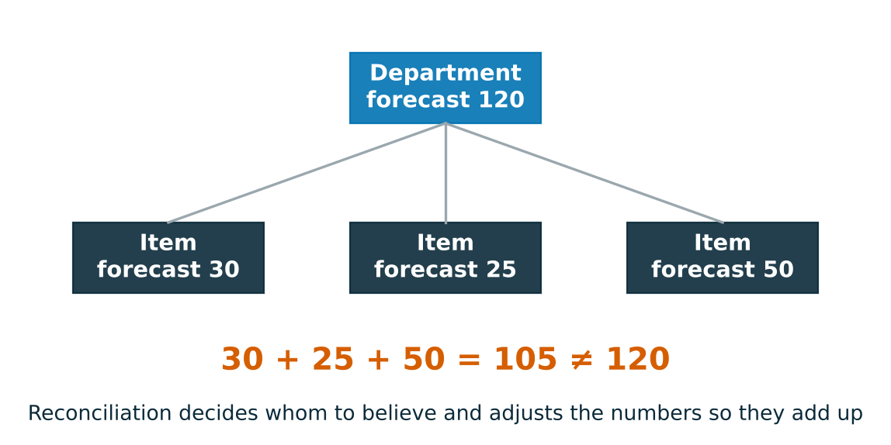

</div>
</div>

<!--
Ask: who in the business reads which level? Buyers read items, finance reads departments and the total. Coherence matters because those people talk to each other.
-->

---

<!-- _class: result -->

# Lab 05: what we found

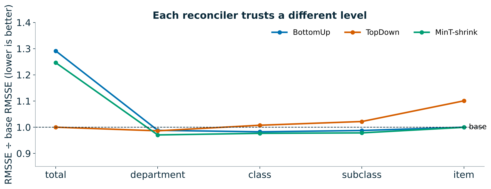

- **BottomUp**: items unchanged, but the total is 29 % worse: small item biases add up across 2,000 items
- **TopDown**: the total is perfect, items are 10 % worse: fixed proportions miss item-level promotions
- **MinT-shrink**: within a few percent of the best at every level, and coherent. Not shown: **MinT-ols** is 3–11× worse below the total, because it weighs a 600-unit item like a 150k one
- On the item leaderboard, reconciliation even helped a little: AutoETS 1.285 → 1.251

<!--
Ratios are relative to the incoherent base forecasts (lower is better). The take-away: reconciliation is cheap and rarely hurts, but the weights matter.
-->

---

# Uncertainty: what are we scoring?

- A forecast for ordering stock is a **distribution**, not a number: quantiles, intervals, samples
- **Calibration**: 80 % intervals contain the truth 80 % of the time
- **Sharpness**: among calibrated forecasts, narrower is better
- **Proper scoring rule**: the expected score is optimised only by reporting your true belief

| Score | For | Formula (per observation) |
|---|---|---|
| Pinball / quantile loss | a quantile q_τ | max(τ(y−q), (τ−1)(y−q)) |
| CRPS | full distribution | ∫ pinball over τ ≈ 2 · mean pinball over quantiles |
| Interval (Winkler) score | [l, u] at 1−α | (u−l) + (2/α)(l−y)₊ + (2/α)(y−u)₊ |

Scale them per series (like RMSSE) before averaging across series.

<!--
20-minute segment with notebook 06 as the live demo. Coverage alone is not a score: [0, ∞) has 100 % coverage.
-->

---

<!-- _class: intuition -->

# Calibration, sharpness and honest scores

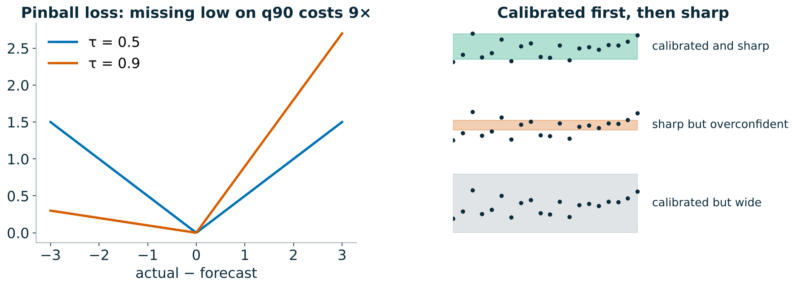

- A weather forecaster who says "30 % chance of rain" should see rain on about 30 % of those days: that is **calibration**
- "Between 0 and 100 mm" is always right and useless: among calibrated forecasts, prefer the **sharpest**
- A **proper** score rewards honesty: you cannot improve your expected score by reporting anything other than what you believe

<!--
The pinball loss on the left is the whole idea of quantile forecasting: for the 90 % quantile, being 1 unit too low costs 9 times as much as being 1 unit too high, so the best answer sits high.
-->

---

# Conformal prediction

**Split conformal** around any point model:
1. Hold out calibration windows (rolling origins in the training data)
2. Conformity scores = |y − ŷ| on those windows, per horizon step
3. Interval = ŷ ± the (1−α) quantile of the scores

- Guarantee: **marginal** coverage ≥ 1−α under exchangeability, in finite samples
- Not guaranteed: coverage **per series**, per promo week, or under drift
- Extensions: **CQR** (conformalise quantile-model intervals), **adaptive** CP for drift, per-segment calibration

In the stack: `PredictionIntervals` (`mlforecast`), `ConformalIntervals` (`statsforecast`); quantile losses (`MQLoss`) in `neuralforecast`.

<!--
In the demo, plot coverage by velocity class: conformal intervals pooled across all series tend to over-cover fast movers and under-cover slow ones, or vice versa.
-->

---

<!-- _class: intuition -->

# Conformal: be as wrong as you were before

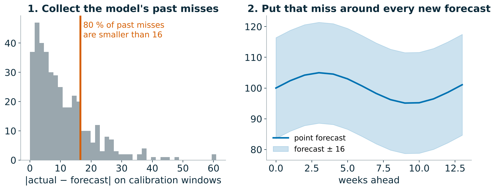

- Look at how wrong the model has been on recent, held-out weeks, and promise **that much** around every new forecast
- It works for **any** model and needs no distribution assumptions
- The promise holds only if the future looks like the past you calibrated on

<!--
That last line is the setup for the result on the next slide: in our test quarter, the future did not look like the calibration windows.
-->

---

<!-- _class: result -->

# Demo 06: what we found

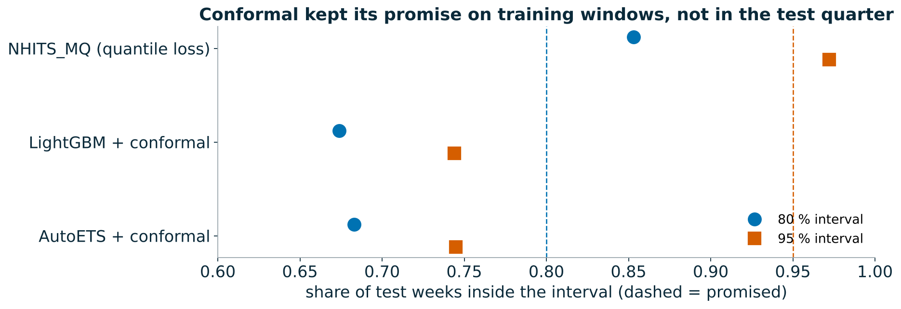

- **NHITS with quantile loss** slightly over-covers (85 % for a promised 80 %) and has the best CRPS (1.47 vs about 2.6): it learned **per-item widths**
- **Conformal** under-covers in the test quarter: 67–68 % instead of 80 %. April–July brought promotions and shifts the calibration windows had not seen, and one width is shared by fast and slow items
- Fixes: calibrate **per class** and on **recent** windows, or conformalise the quantile model (**CQR**)

<!--
Good moment to repeat: the conformal guarantee is marginal and assumes exchangeability. It did exactly what it promised on the data it was calibrated on.
-->

---

<!-- _class: lab -->

# Model selection and ensembling · `07` (20 min)

- **Win rate**: share of series where A beats B (ties count ½)
- **Bradley–Terry**: P(A beats B) = s_A / (s_A + s_B), fitted on all series-level duels
- **Elo**: replay series as matches, update `r ← r + K(s − E)`, average over shuffles
- **By volume** (velocity class A–J) and **shape** (smooth / erratic / intermittent / lumpy, feature clusters)
- **Ensembles**: mean, median, top-3, best-per-class, chosen on **half the series**, scored on the other half

<!--
Point to watch: rating order vs mean-RMSSE order. A model can win most duels by a little and still lose on the mean because of a few large misses (often promo spikes on fast movers).
-->

---

<!-- _class: intuition -->

# Ratings: a league table for models

<div class="cols">
<div>

- Treat every series as a **match** between two models: whoever has the lower RMSSE wins
- **Win rate**: how often A beats B. It ignores by how much, so one disaster cannot dominate
- **Elo / Bradley–Terry** turn all the matches into one rating, like chess: **+100 points ≈ 64 %** chance to win a series
- **Ensembles**: a panel of forecasters whose mistakes partly cancel

</div>
<div>

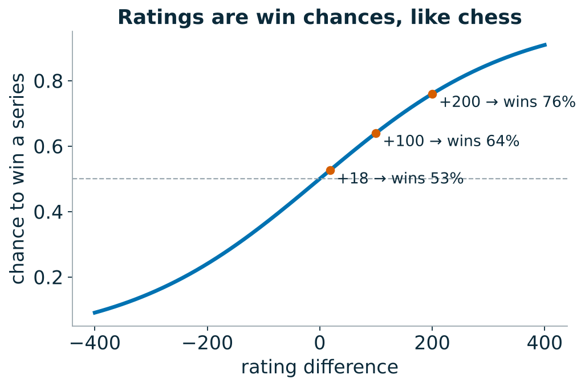

</div>
</div>

<!--
Mean RMSSE answers "who is best on average, including disasters"; ratings answer "who usually wins". Both are legitimate; they disagree when a model is consistently a little better but occasionally very wrong.
-->

---

<!-- _class: result -->

# Lab 07: what we found

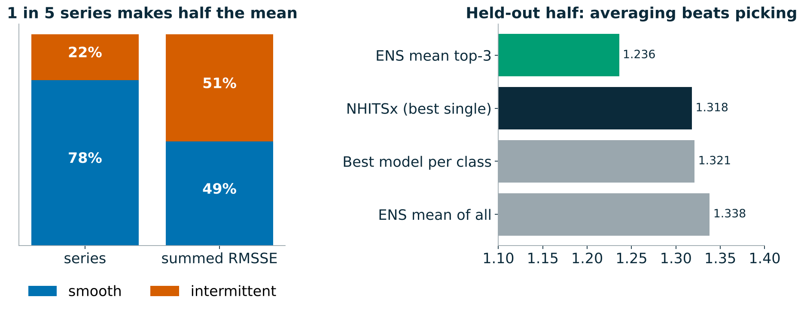

- **Ratings and the mean disagree**: LightGBM is 4th on mean RMSSE but 2nd by Bradley–Terry. It wins more series by a little and loses some intermittent ones by a lot
- **430 intermittent series (22 %) make 51 % of the summed RMSSE**: the mean is mostly a contest about the hardest items
- On the **held-out half**, the plain average of the top 3 beats every single model (1.24 vs 1.32): their errors partly cancel
- Picking the best model **per class** looked great on the selection half and did not carry over: **selection overfits, averaging does not**

<!--
The final leaderboard: ENS_mean_top3 (NHITSx + LightGBM + NHITS_noexog) at 1.032 is the overall winner of the day, about 12 % better than the best Day 1 model.
-->

---

# Final standings

Run the last cells of `07`; the chart is saved to `results/day2/final_standings.png`

**Decision framework to take home**
1. Baselines first
2. Global before deep: the tuned GBDT is the bar
3. Tune the few things that matter, then stop
4. Check responsiveness before accuracy when the forecast drives prices or promos
5. Foundation models: strong zero-shot baseline; fine-tune when validation says so and the budget allows
6. Reconcile when several levels are consumed
7. Report win rates and segments, ensemble when nobody dominates

<!--
5 minutes. Announce the top three, then go back to the open questions from the recap slide and answer them with today's numbers.
-->

---

<!-- _class: result -->

# This morning's questions, answered

| Question from the recap | What today's numbers say |
|---|---|
| Is the GBDT strong because it is **global** or because of **covariates**? | Mostly **global**: NHITS without covariates (1.148) already matches LightGBM (1.169); covariates add a few percent, mostly in promo weeks |
| Can a neural net learn the hand-built features? | **Yes, about as well**, from the raw window |
| What does it cost? | 20–30 s per neural fit vs 1.6 s; tuning 474 s for 1 % |
| Does it **respond to price** the right way? | **Direction yes, size no**: promo lift +9 % to +28 % vs +72 % in the data |
| Best of the day? | The **average of the top 3** (1.032), about 12 % better than the best Day 1 model |

<!--
Close the loop explicitly: go back to slide 4's open questions and read this table out. Then the decision framework on the previous slide is the take-home.
-->
