<!-- _paginate: false -->

# Time Series Bootcamp · Day 2
## Deep learning, foundation models and advanced topics

Packt Nov 2026 · Weekly retail sales · 18,692 products · one supermarket
`neuralforecast` · `statsforecast` · `mlforecast` · `timecopilot` · `polars`

<!--
This copy carries the full-panel results from day2_neural/code_full (trained on all 17,241 series on a GPU, scored on the original labs' 2,000-series sample; notebook 11 rescores on all 17,238). The v1 deck is on lm.day2-slides.

Welcome back. Yesterday: baselines, evaluation, gradient boosting. Today: neural global models, tuning, covariates, foundation models, hierarchy, uncertainty, and how to pick and combine models. Same data, same split, same leaderboard.
-->

---

<!-- _class: dense -->

# Today

| Time | Segment | Type | Notebook |
|---|---|---|---|
| 0:00 | Recap: Day 1 leaderboard | talk | `00` |
| 0:10 | Deep learning for global models; ML vs NNs | talk | |
| 0:35 | Default training with GFMs | **lab** | `01` |
| 0:55 | Hyperparameter optimisation | **lab** | `02`, `05` |
| 1:25 | *Break* | | |
| 1:40 | Exogenous variables and responsiveness | **lab** | `03`, `04`, `05b`, `05c` |
| 2:10 | Foundation models | talk | |
| 2:20 | Foundation models: tune or not? | **lab** | `07`, `07b` |
| 2:50 | Hierarchy and coherence | **lab** | `08` |
| 3:10 | Uncertainty: scoring and conformal | talk + demo | `09` |
| 3:25 | Model selection and ensembling | **lab** | `06`, `10`, `11` |
| 3:45 | Wrap-up | | |

> **Takeaway:** One leaderboard: every model trains on all 17,241 items and is judged on the same 2,000 items and 14 test weeks.

<!--
About 65 minutes of talk and 150 minutes of labs, with a 15-minute break and 5 minutes of slack. The notebooks are day2_neural/code_full: every model trains on all 17,241 eligible series (GPU, cached, so on the day they load in seconds) and is scored on the original labs' stratified 2,000-series sample; notebook 11 rescores the main models on all 17,238 scorable series. The headline score is median RMSSE, with the mean alongside.
-->

---

<!-- _class: intuition -->

# Recap: the rules of the game

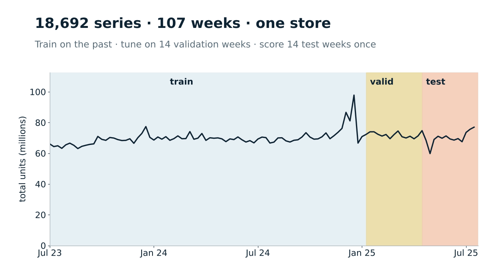

- Train on all 17,241 eligible items, same split as Day 1: train to 2025-04-09, **test = the next 14 weeks**; score on the same **2,000-item evaluation sample** (all 17,238 in notebook 11)
- **RMSSE** = my error ÷ the error of "copy the same week last year" on the item's own history. Below 1 beats the yardstick; scale-free, so a 600-unit and a 150k-unit item count the same
- Headline: **median RMSSE** (the typical item), with mean RMSSE, **WAPE** (volume-weighted) and **fit time** alongside. Every lab ends with `gd.record(...)`

> **Takeaway:** Same data, same split, same score as Day 1, so every number today is comparable.

<!--
The video loops the panel, the split and one series per demand type (in the pptx it plays on click; the PDF shows a still). Run notebook 00 live; it rebuilds the Day 1 references so the leaderboard is never empty. Ask the room: if RMSSE were 1.0 for every item, what would that mean? (We are exactly as good on the future as copying last year was on the past.) Above 1 is normal out of sample.
-->

---

<!-- _class: result -->

# Recap: Day 1 leaderboard

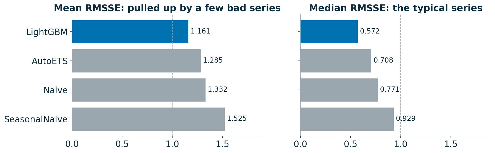

- **Last week beats last year** (Naive 0.77 vs SeasonalNaive 0.93, median): under two years of history, and promotions move around the calendar
- **Median 0.57, mean 1.16** for LightGBM: the typical item is forecast well; intermittent, mostly-zero items drag the mean up
- **Today's open questions**: is the GBDT strong because it is *global* or because it sees *covariates*? Can a neural net learn the features? At what cost? Does it respond to price the right way?

> **Takeaway:** Keep mean and median in view all day; the gap between them is the hard items.

<!--
Numbers are from the full-panel run (trained on 17,241 series, scored on the 2,000-item sample; LightGBM reads the cleaned prices, see notebook 05c). The open questions come back on the second-to-last slide with today's answers.
-->

---

<!-- _class: intuition -->

# Why one model for 17,000 series works

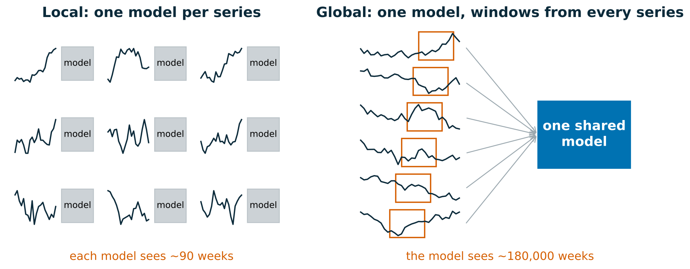

- A **local** model is a shop assistant who has watched one shelf (~90 weeks). A **global** model has watched the whole store (~180,000 weeks), so it recognises a promo spike even on a new item
- The catch: it learns **typical** behaviour. Per-window scaling and covariates adapt it to each item
- Today's models, all in `neuralforecast`: **N-HiTS / N-BEATS** (stacked MLPs, fast) and **TFT** (attention over covariates, 5–10× slower, optional in lab 01)

> **Takeaway:** One network trained on windows from every item pools evidence across the whole store.

<!--
The single most important idea of the morning. N-BEATS: Oreshkin et al. 2020, beat the M4 winner with pure deep learning. N-HiTS: Challu et al. 2023, cheaper and better at long horizons. TFT: Lim et al. 2021, variable selection plus attention; worth it with rich covariates and a GPU.
-->

---

<!-- _class: intuition -->

# N-BEATS as a relay race

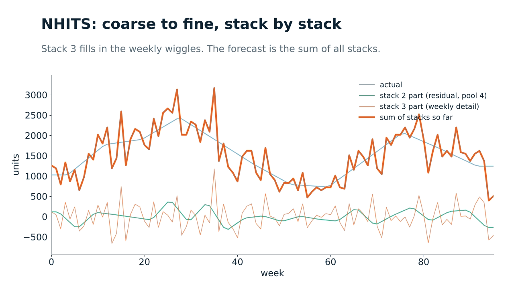

- Each block explains what it can of the input, **subtracts it**, and hands the rest on. The forecast is the sum of what every block carried
- **Interpretable** N-BEATS forces block 1 to be a trend and block 2 a season. Its sine waves repeat every 14 weeks (the horizon) or faster, so it **cannot** see a 52-week year
- **N-HiTS** runs the same relay on blurred (pooled) inputs, coarse to fine: cheaper and smoother

> **Takeaway:** Explain, subtract, pass on: the forecast is the sum of what each block carried.

<!--
The video shows N-HiTS doing exactly this on a real series: stack 1 draws 12 knots, stacks 2 and 3 add what is left. Residual stacking is just "explain, subtract, pass on". Lab 01 trains generic and interpretable N-BEATS side by side: the prior buys plots, not accuracy, on this data.
-->

---

<!-- _class: dense -->

# Neural global models vs GBDTs

| | GBDT (LightGBM via `mlforecast`) | Neural GFM (`neuralforecast`) |
|---|---|---|
| Features | **you build them**: lags, rolling stats, calendar | learned from the raw window (+ covariates) |
| Multi-step | recursive or one model per step | direct: whole horizon at once |
| Scaling | target transform per series | per-window scaler inside the model |
| Cost | minutes on CPU, robust defaults | longer, GPU helps; sensitive to lookback, lr, steps |
| Monotone constraints | **built in** | not available |
| Probabilistic | quantile objective or conformal | quantile / distribution losses |

**Evidence**: M5 (Walmart) was won by LightGBM ensembles; N-BEATS / N-HiTS shine on long, regular series.

> **Takeaway:** GBDT: you engineer the features, cheap to train. NN: learns them from windows, costs more to train and tune.

<!--
Costs to call out: GPU hours, feature pipelines, two different MLOps stacks. For a weekly batch job of 20k series both are cheap to serve; the real cost is training and tuning iterations.
-->

---

<!-- _class: intuition -->

# Scaling: compare shapes, not sizes

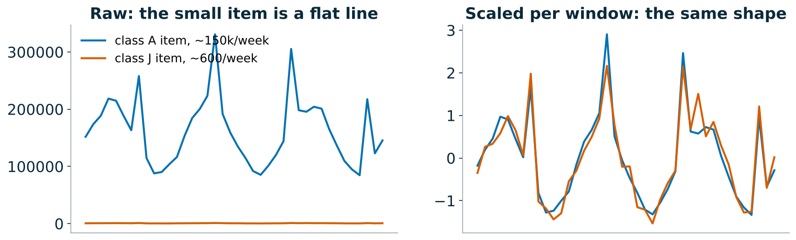

- Unscaled, a class J item (~600/week) is a flat line next to a class A item (~150k/week), and the network learns only the big ones
- Scaled **per window**, both show the same shape, which is what a global model needs to learn
- Same reason covariates must be **relative** (price index, discount depth): a raw price of 0.99 vs 39.99 says nothing about a discount

> **Takeaway:** Make items of every size look alike, and give networks relative, not raw, covariates.

<!--
NHITSx broke during preparation when fed raw sale prices: the network saw "expensive item" instead of "cheaper than usual". GBDTs instead transform the target per series (LocalStandardScaler).
-->

---

<!-- _class: intuition -->

# Evaluate like you forecast: rolling origins

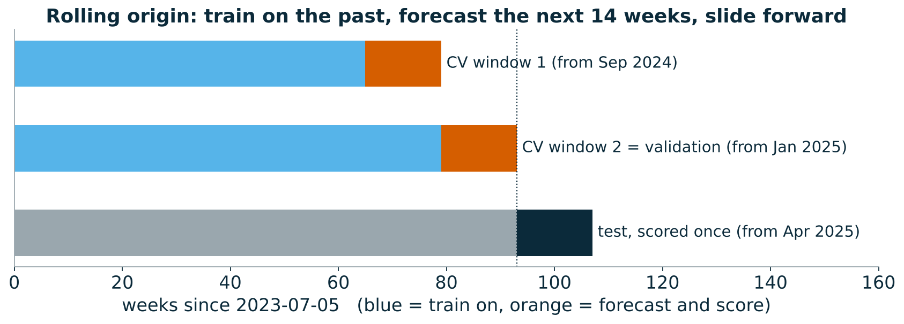

- Pretend it is an earlier date, train on what was known then, forecast 14 weeks, score, slide forward. **Never random K-fold**: it trains on the future
- Windows differ in difficulty, so compare models **on the same windows**
- NNs are stochastic: **re-run seeds** before believing a 1 % gap. `val_size` only pays off with early stopping or a search; otherwise it just drops the latest weeks

> **Takeaway:** Time-ordered windows, same windows for every model, and seed reruns before believing small gaps.

<!--
Every choice today is made on one validation window (the 14 weeks before the test window) and scored once on test. Lab 02 measures the seed noise floor: the same settings, three seeds, move the median by about 0.005.
-->

---

<!-- _class: intuition -->

# The loss decides which number you get

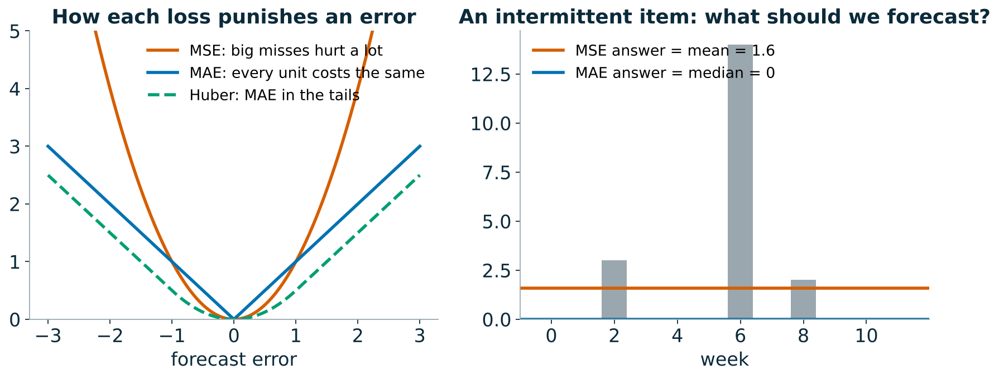

- Train on **MSE** and the model aims for the **mean**; on **MAE**, the **median**; on pinball loss, a **quantile**
- For an item that sells nothing most weeks, the median is **0**: an MAE model may forecast zero and stock nothing
- Pick the loss for the decision, then check on validation. Our recipe trains on **Huber** (squared for small errors, absolute for big ones, so promo spikes cannot dominate)

> **Takeaway:** MSE → the mean, MAE → the median, pinball → a quantile.

<!--
Ask: which number do you want for a slow mover that sells 0, 0, 3, 0, 0, 0, 14? Poisson/Tweedie losses are the other option for count data.
-->

---

<!-- _class: lab -->

# Default training with GFMs · `01` (20 min)

1. **Wrangle**: polars panel → pandas long format; target shifted by +1 for safe scaling
2. **Train NBEATSx three ways**, 3 seeds each: library defaults · the research **recipe** (Huber loss, warm-up then step decay, gradient clip 1.0, keep the best weights, steps scaled to the data) · NHITS with the same recipe
3. Compare median RMSSE **and the seed spread**; `gd.record(...)` → leaderboard

**Discuss**: how much of a neural model's score is the architecture, and how much is the training?

<!--
On the GPU each fit takes 4–9 minutes (≈ 11,700 steps); the notebooks load the cached runs. The recipe is from our earlier GFM research (docs/gfm_learnings.md): it took that work from 3 usable runs in 6 to 6 in 6.
-->

---

<!-- _class: result -->

# Lab 01: what we found

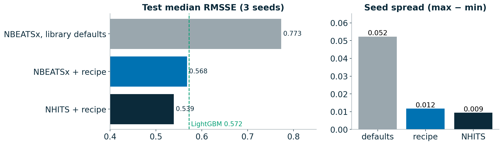

- **Training is most of the battle**: NBEATSx off the shelf scores 0.773 with a seed spread of 0.052; with the recipe, 0.568 with 0.012
- **The recipe catches LightGBM** (0.572) and **NHITS beats both** (0.539) at half the cost: 4 minutes per fit against 8.5
- We kept **NBEATSx** for its exogenous block, which reads the price plan directly: the price questions later need it

> **Takeaway:** Get the training right before tuning anything: it moved the score more than any setting did.

<!--
Seed spread = best minus worst of three seeds on median RMSSE. Off-the-shelf training is not only worse, it is unreliable: one seed in three can land far from the others.
-->

---

<!-- _class: lab -->

# Hyperparameter optimisation · `02`, `05` (30 min)

1. **Noise floor**: refit the recipe with 3 seeds; a gap smaller than the seed spread is a tie, not a finding
2. **Grid** (`02`): 12 cells of blocks × width × learning rate, scored on the **validation** window
3. **Optuna** (`05`): 30 trials on two goals at once, accuracy and price response; confirm the Pareto front's finalists with 3 seeds, then test once

*TPE in plain words: after a few random tries, propose settings that look like the good trials and unlike the bad ones.*

<!--
05 keeps the price-response measure (the elasticity at ±20%) next to accuracy, so we can see whether tuning buys response or only accuracy.
-->

---

<!-- _class: result -->

# Lab 02: what we found

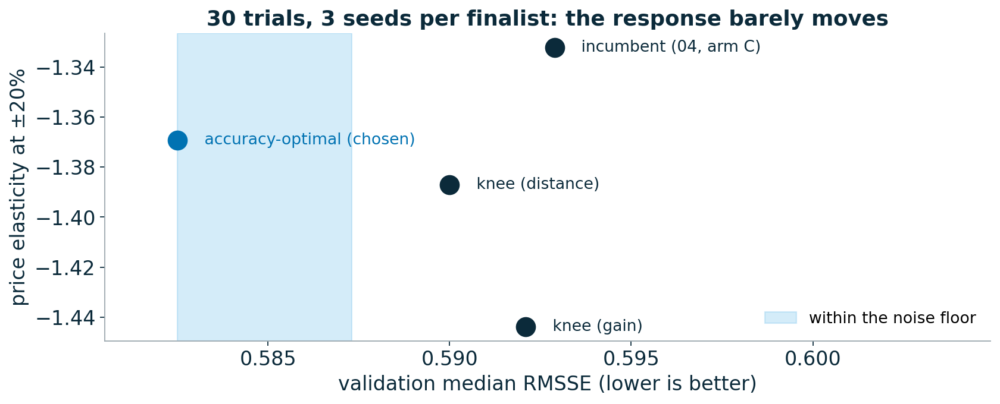

- **Noise floor**: same settings, three seeds → median RMSSE moves by **0.005**
- **The grid finds nothing**: the recipe's defaults were already the best of 12 cells; nothing else came within the noise floor
- **Optuna, 30 trials**: the accuracy-optimal trial wins (validation 0.583, test 0.546 against 0.553). The price response barely moves across the front (−1.33 to −1.44)

> **Takeaway:** Measure the seed noise first, tune on validation, and expect tuning to move accuracy, not price response.

<!--
The finalists are the accuracy-optimal trial, two "knee" trials (best trade-off by gain and by distance) and the incumbent from 04. All four are within 0.01 of each other on validation.
-->

---

<!-- _paginate: false -->

# Break · 15 min

---

<!-- _class: lab -->

# Exogenous variables and responsiveness · `03`–`05c` (30 min)

- **Future** covariates the model may use: planned price index, promo flag, discount depth; **static**: log mean sales, share of zero / promo weeks
- **Accuracy** asks "did you predict what happened?"; **responsiveness** asks "if we changed the price, would you predict the right thing?"
- **Arms**: calendar and hierarchy features (`03`); price features, CPI deflation, oversampling (`04`); synthetic discounts (`05b`); cleaned prices and a stable scaler (`05c`)
- **What-if probes**: cut the price 10–30 % in one week, **rebuild every input built from price**, and read the forecast lift

<!--
Confounding: retailers cut prices when they expect high demand, so a model can learn "cheaper → fewer sales". Elasticity −2 means a 10 % price cut gives about 20 % more units. Moving price_index alone understates the response: LightGBM gives +5 % that way, +28 % with discount depth rebuilt.
-->

---

<!-- _class: result -->

# Lab 03: what we found

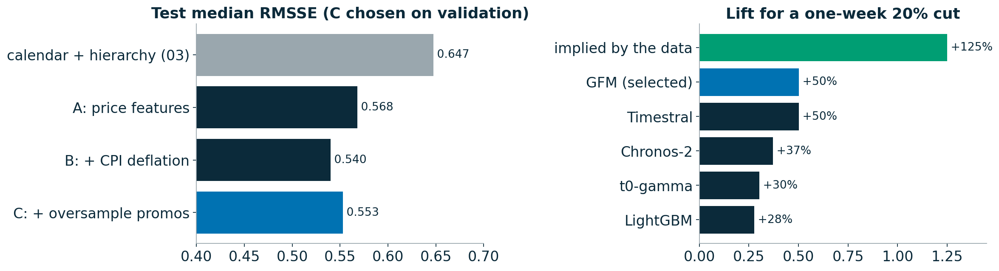

- **Calendar and hierarchy features hurt** (0.647 against 0.568): Fourier and event inputs make the model overfit
- **CPI deflation helps** accuracy and response (0.568 → 0.540); **oversampling** deepens the response further and wins on validation. Synthetic discounts (`05b`) did not help
- **Every model is right-signed and too weak**: a 20 % cut implies +125 % in the data; the best models forecast +50 %

> **Takeaway:** Judge covariates on accuracy and on response, and check the size of the response, not just its sign.

<!--
The data's elasticity (≈ −3.6) comes from short, deep promotional cuts; the models may be learning the promotion flag more than the price. The GFMs are the most consistent: 99 % of random promotion cuts lift their forecast, against about 90 % for the foundation models.
-->

---

<!-- _class: result -->

# Making the GFM stable · `05c`

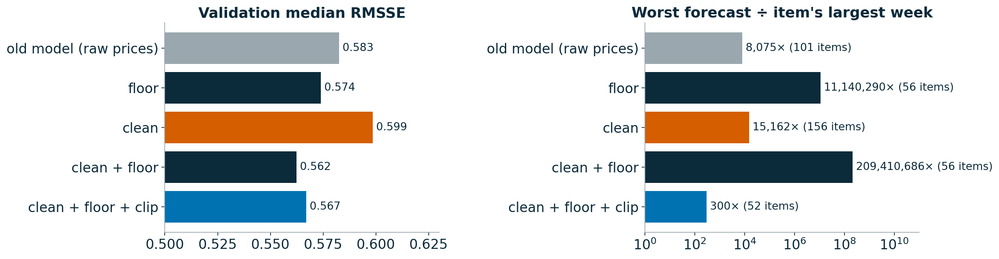

- **Scored on every item, a few hundred forecasts exploded** (up to 8,000× the item's best week). Causes: £0.01 **placeholder prices**, and the per-window scaler **dividing by a near-zero spread** when a price barely moved
- **Fixes**: clean the prices (replace placeholders and wrong-unit weeks), floor the scaler's spread at 0.01, clip scaled inputs at ±50. A 3× cap stays as the safety net
- **Safer and better**: median RMSSE 0.546 → **0.520**; worst forecast 300× the item's best week (8,000× before), steadier training

> **Takeaway:** Bounded inputs mean bounded gradients and bounded forecasts: stability made the model more accurate, not just safer.

<!--
A steady shelf price drifts ≈ 0.07 % a week after CPI deflation, so discount_depth sits near 0.001 with a spread of 0.0004; a 20 % cut then scales to about +500, against −5…+5 for ordinary inputs, and the exogenous block passes it linearly into the forecast. Clean + floor and clean + floor + clip tie on validation (0.562 against 0.567); we carry the clipped one forward for stable calculations. One rare blow-up inside the network remains (one seed, one best seller), so the cap stays. Full explanation: docs/stability_choices.md.
-->
---

<!-- _class: intuition -->

# Foundation models: the well-travelled forecaster

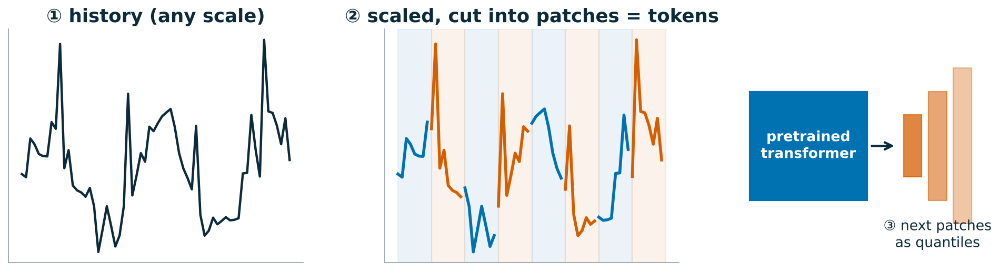

- **Recipe of a language model**: scale the history, cut it into patches ("words"), let a transformer predict the next patches as quantiles, after pretraining on millions of series
- **Zero-shot** = a consultant who has seen every industry but not your shop; **fine-tuned** = the same consultant after a week of induction, better on your quirks but now you pay for training
- **Chronos-2**, **t0-gamma** and **Timestral** read covariates (your price and promotion plan); with ≤ 93 weeks of history, context length is not the bottleneck, the prior is

> **Takeaway:** Try zero-shot first; fine-tune only when validation shows a clear gain worth the GPU time.

<!--
Other models: Chronos-Bolt (Amazon), TimesFM (Google), Moirai (Salesforce); timecopilot wraps them behind one forecast(df, h, freq) API. Benchmark caveat: public test sets may be in the pretraining data. Measure seconds per 1,000 series: foundation models cost more per forecast than LightGBM or NHITS.
-->

---

<!-- _class: lab -->

# Foundation models: zero-shot or train? · `07`, `07b` (30 min)

1. **Zero-shot** Chronos-2 with and without the price and promotion plan (`07`)
2. **Newer models** t0-gamma and Timestral (`07b`): four input setups, chosen on **validation**; paired Wilcoxon tests against Chronos-2 and the GFM
3. Probe the **price response** the same way as the GFMs; measure **seconds per 1,000 series**

| | Accuracy vs the GFM | Cost | Decision |
|---|---|---|---|
| zero-shot + covariates | ? | ? | |
| fine-tuned | ? | ? | |

<!--
Fine-tuning Chronos-2 is built into 07 but switched off (GD_FM_FINETUNE); t0-gamma and Timestral are run zero-shot only. Timestral's weights need a separate licence above $20M monthly revenue; Chronos-2 and t0-gamma are Apache-2.0.
-->

---

<!-- _class: result -->

# Foundation models: what we found

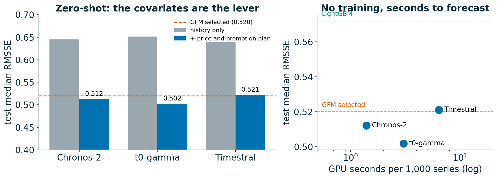

- **The price plan is the lever**: every model drops from ≈ 0.65 to ≈ 0.50–0.52 with it, with no training at all
- **t0-gamma is the best single model** (0.502): it beats Chronos-2 (0.512) by twice the noise floor, p ≈ 0. Timestral (0.521) ties Chronos-2 and the GFM (0.520)
- **They need the whole history** (≈ 0.60 with 13 or 26 weeks) and **respond least to price**: t0-gamma +30 % for a 20 % cut, against +50 % for the GFM

> **Takeaway:** Zero-shot foundation models with the price plan forecast best; ask the trained GFM what a new price would do.

<!--
Cost on one GPU: 1.4 s (Chronos-2), 3 s (t0-gamma) and 6.4 s (Timestral) per 1,000 series with covariates. Event dummies and tree-style inputs change little (≤ 0.025). Averaging pairs of foundation models helps (t0-gamma + Chronos-2 0.491), but their errors correlate at 0.99. If asked whether the realized price leaks sales: a week with no sales is recorded at exactly the regular price, and notebook 12 measures it. Removing that fingerprint costs every model 0.005–0.008 (about one noise floor, no ranking changes); knowing the price at all is worth 0.11–0.15, and without future prices every model is level with Day 1's best LightGBM (≈ 0.66).
-->

---

<!-- _class: lab -->

# Hierarchy and coherence · `08` (20 min)

- Forecast every level separately and the items will not add up to the department, like a budget whose lines disagree with its total
- **BottomUp** trusts the items, **TopDown** trusts the total, **MinTrace** weighs each level by how reliable it has been
- Items from the **GFM** or **Chronos-2**; upper nodes from ETS, ARIMAX or Chronos-2 with the nodes' price inputs, chosen on validation

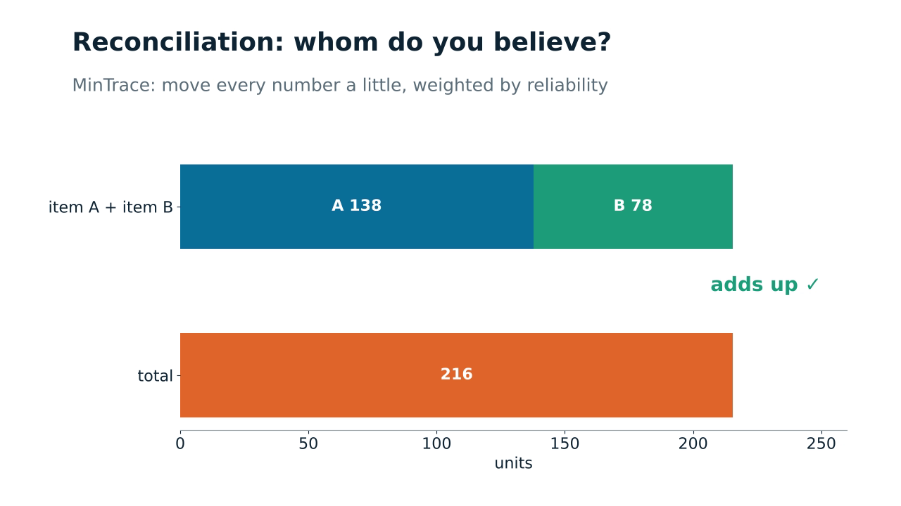

<!--
The video morphs incoherent base forecasts into BottomUp, TopDown and MinTrace. Total → 148 departments → 502 classes → 1,467 subclasses → 17,216 items. MinTrace variants: ols weighs every node equally, wls_struct by how many items sit below, wls_var by each node's own past error variance, shrink-sub adds shrunk covariances. The library's sparse MinT solver stopped early without saying so; gd.MinTraceDirect solves the same equations exactly (37 minutes → 16 seconds). Ask: who reads which level? Buyers read items, finance reads departments.
-->

---

<!-- _class: result -->

# Hierarchy: what we found

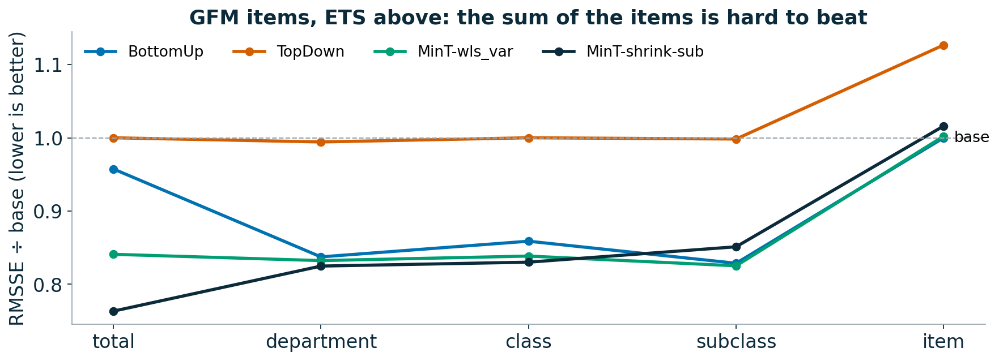

- **BottomUp wins on the rule** (judge each method by its worst level) for both item models: good item forecasts make their sum hard to beat
- **Weighted MinT wins the upper levels**: shrink-sub is best at the total (0.680 against 0.853) and in departments and classes, but loses a little at the items
- **Upper model: ETS**, although Chronos-2 with the nodes' prices was 28 % better below the total: it was 5 % worse at the total itself

> **Takeaway:** Choose the reconciler by who reads which level; with good items, BottomUp is a strong default.

<!--
Ratios are RMSSE divided by the incoherent base. Every item forecast is capped at 3× its largest training week. The GFM's saved seed is the one with the remaining blow-up (one best seller), so its bottom-up total is ≈ 4 % too high (Chronos-2 items: ≈ 2 %).
-->

---

<!-- _class: intuition -->

# Scoring uncertainty: calibrated, then sharp

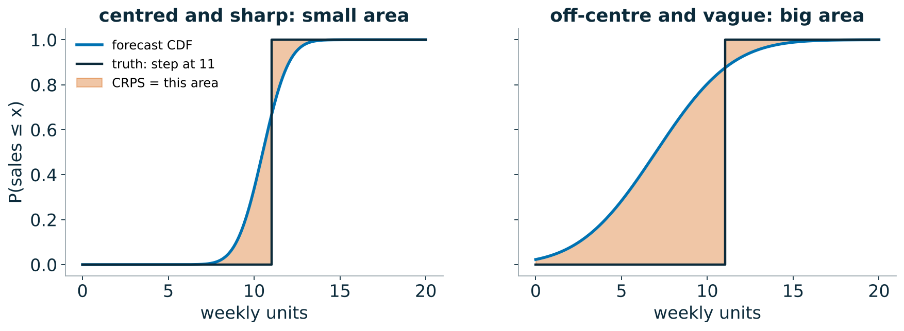

- **Calibration**: an 80 % interval should contain the truth 80 % of the time. **Sharpness**: among calibrated forecasts, narrower is better. Coverage alone is not a score: [0, ∞) always covers
- **CRPS** = the area between the forecast CDF and the step at the actual value: small when centred and confident. For a single number it equals the absolute error
- **Interval score**: width plus a penalty for every miss. Scale both per series before averaging

> **Takeaway:** Judge intervals by calibration first, then sharpness, with a proper score.

<!--
Proper score: you cannot improve your expected score by reporting anything other than what you believe. Pinball loss for the 90 % quantile: being 1 unit too low costs 9 times as much as 1 unit too high.
-->

---

<!-- _class: intuition -->

# Conformal: be as wrong as you were before

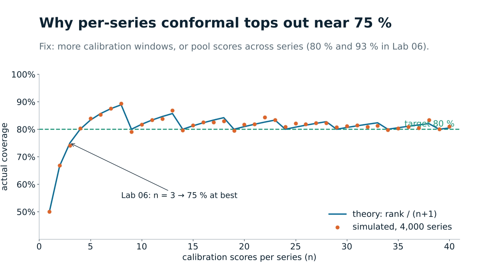

- Collect the model's errors on held-out past windows, and put **that much** around every new forecast. Works for **any** model
- The guarantee needs enough errors: at least ⌈(n+1)(1−α)⌉ ≤ n, i.e. **19 for a 95 % interval**
- With 3 windows per series, a 95 % interval is just the largest of 3 errors, and a new error beats it 1 time in 4. **Pooling** scale-free errors across series fixes this

> **Takeaway:** Conformal turns past errors into intervals for any model, given enough past errors.

<!--
The video sweeps n from 1 to 40: coverage is capped at n/(n+1) until n ≥ 4 for 80 %. In the stack: PredictionIntervals (mlforecast), ConformalIntervals (statsforecast), MQLoss in neuralforecast. Not guaranteed: coverage per series, per promo week, or under drift. Extensions: CQR (conformalise quantile intervals), adaptive conformal for drift.
-->

---

<!-- _class: result -->

# Uncertainty: what we found

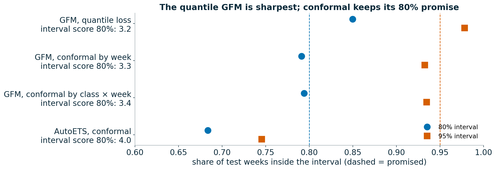

- **GFM with a quantile loss**: 85 % for a promised 80 %, and the best interval score (3.2) and CRPS: widths that follow each item and week
- **Conformal around the GFM** keeps the 80 % promise (79 %) but at 95 % a few large misses beyond anything in the calibration errors dominate the score (36)
- **Per-series conformal for ETS**: 68 % for 80 %, 75 % for 95 %: too few past errors per series

> **Takeaway:** A conformal promise needs enough past errors, and honest width is not yet useful width.

<!--
Calibration: 28,000 errors from 2,000 series on the validation window, pooled by forecast week (or class × week). Fixes that add shape and keep the guarantee: conformalise the quantile model (CQR).
-->

---

<!-- _class: lab -->

# Model selection and ensembling · `06`, `10`, `11` (20 min)

- **One model or one per cluster?** (`06`): pooled GFM against a cluster static and per-cluster models
- Treat every series as a **match** between two models: lower RMSSE wins; **win rate**, **Bradley–Terry** and **Elo** turn matches into ratings
- **Ensembles** chosen on half the series, scored on the other half (`10`)
- **Every item** (`11`): rescore the main models on all 17,238 series

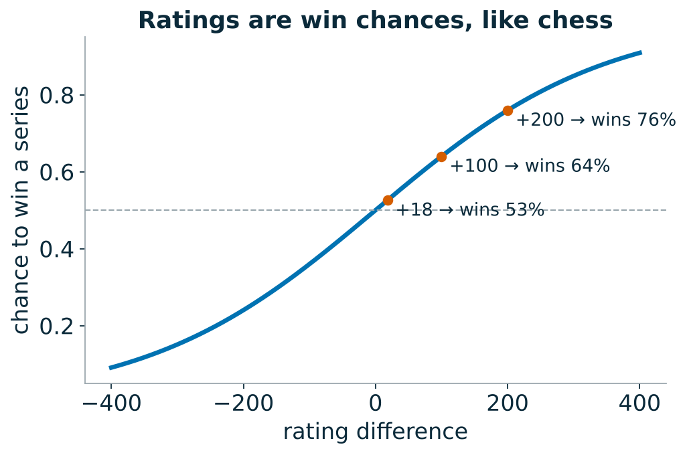

<!--
The final-model rule, fixed before looking: keep the selected GFM unless another single model beats it by more than the noise floor.
-->

---

<!-- _class: result -->

# Selection: what we found

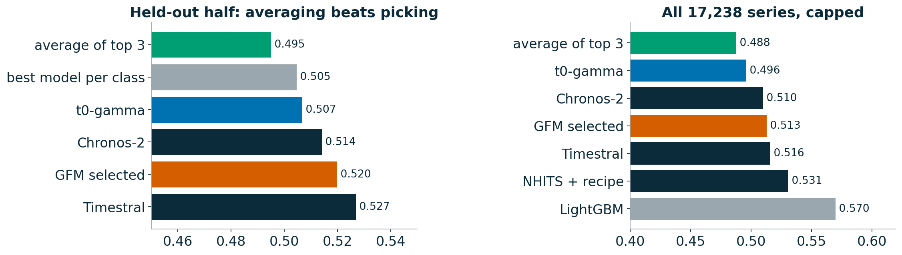

- **One pooled model beats clusters** (0.520 against 0.526 with a cluster static, 0.542 per cluster)
- **Final model: t0-gamma** (0.501), by the rule fixed in advance. On the **held-out half** the **top-3 average** (t0-gamma, Chronos-2, Timestral) beats it (0.495 against 0.507); picking per class lands in between
- **On all 17,238 items** the order holds: top-3 average 0.488, t0-gamma 0.496, GFM 0.513; the 2,000-item sample was a good stand-in

> **Takeaway:** No model wins everywhere; averaging a few good models is the safest pick.

<!--
All-series scores are capped at 3× each item's largest training week, for every model. WAPE follows the best sellers, so it moves more than the median between the sample and all items. Same data and scoring as the v1 labs: the baselines and Chronos-2 match them to three decimals.
-->

---

<!-- _class: result -->

# This morning's questions, answered

| Question | What today's numbers say |
|---|---|
| **Global** or **covariates**? | **Both**: the price plan is worth ≈ 0.13 of RMSSE to the foundation models |
| Can a neural net learn the features? | **Yes, if trained well**: the recipe took NBEATSx from 0.773 to 0.568, past LightGBM (0.572) |
| What does it cost? | 4–9 GPU minutes per neural fit; foundation models 1–6 s per 1,000 series |
| Does it **respond to price** correctly? | **Direction yes, size timid**: +30 % to +50 % for a 20 % cut against +125 % in the data |
| Best single model? | **t0-gamma, zero-shot with the price plan**: 0.501, against 0.512 for Chronos-2 and 0.520 for the GFM |
| Best of the day? | The **average of the top 3**: 0.495 on the held-out half, against 0.507 for t0-gamma |

<!--
Close the loop: go back to the open questions from the recap and read this table out.
-->

---

<!-- _class: summary -->

# Take home

| Block | The one idea |
|---|---|
| **Global deep models** | One model learns from every item; NN vs GBDT trades feature work for training cost |
| **Training and tuning** | Get the loss and lookback right, check gains against seed noise, then stop |
| **Covariates** | Accuracy is not responsiveness: check what the model does when price or promotion changes |
| **Stability** | Clean the inputs and bound what the network can see: bounded inputs, bounded forecasts |
| **Foundation models** | With the price plan, the most accurate models of the day, with no training |
| **Hierarchy and uncertainty** | Reconcile with good weights; intervals need enough calibration errors |
| **Selection** | Look beyond the mean, then average the best few models |

<!--
5 minutes. Announce the top three on the room's leaderboard, then read this table as the take-home.
-->
