<!-- _paginate: false -->

# Time Series Bootcamp · Day 2
## Deep learning, foundation models and advanced topics

Packt Nov 2026 · Weekly retail sales · 18,692 products · one supermarket
`neuralforecast` · `statsforecast` · `mlforecast` · `timecopilot` · `polars`

<!--
Welcome back. Yesterday: baselines, evaluation, gradient boosting. Today: neural global models, tuning, covariates, foundation models, hierarchy, uncertainty, and how to pick and combine models. Same data, same split, same leaderboard.
-->

---

<!-- _class: dense -->

# Today

| Time | Segment | Type | Notebook |
|---|---|---|---|
| 0:00 | Recap: Day 1 leaderboard | talk | `00` |
| 0:10 | Deep learning for global models; ML vs NNs | talk | |
| 0:35 | Default training with GFMs | **lab** | `01` |
| 0:55 | Hyperparameter optimisation | **lab** | `02` |
| 1:25 | *Break* | | |
| 1:40 | Exogenous variables and responsiveness | **lab** | `03` |
| 2:10 | Foundation models | talk | |
| 2:20 | Foundation models: tune or not? | **lab** | `04` |
| 2:50 | Hierarchy and coherence | **lab** | `05` |
| 3:10 | Uncertainty: scoring and conformal | talk + demo | `06` |
| 3:25 | Model selection and ensembling | **lab** | `07` |
| 3:45 | Wrap-up | | |

> **Takeaway:** Six labs feed one leaderboard: every model is judged on the same 17,241 items and the same 14 test weeks.

<!--
About 65 minutes of talk and 150 minutes of labs, with a 15-minute break and 5 minutes of slack. Every lab runs on all 17,241 eligible series by default, on a laptop CPU; on a slow machine set BOOTCAMP_N_SERIES=2000 for a stratified sample, and anyone with a GPU can raise BOOTCAMP_MAX_STEPS to 1500. The full 53-slide version of this deck is in slides/day2_slides_full.md for anyone who wants more background.
-->

---

<!-- _class: intuition -->

# Recap: the rules of the game

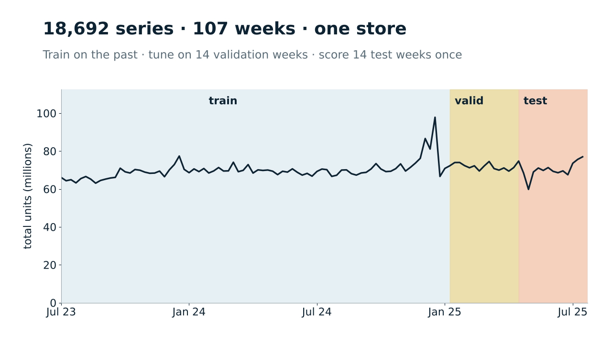

- All 17,241 eligible items of the store, same split as Day 1: train to 2025-04-09, **test = the next 14 weeks**
- **RMSSE** = my error ÷ the error of "copy the same week last year" on the item's own history. Below 1 beats the yardstick; scale-free, so a 600-unit and a 150k-unit item count the same
- Also tracked: median RMSSE, **WAPE** (volume-weighted) and **fit time**. Every lab ends with `bc.record(...)`

> **Takeaway:** Same data, same split, same score as Day 1, so every number today is comparable.

<!--
The video loops the panel, the split and one series per demand type (in the pptx it plays on click; the PDF shows a still). Run notebook 00 live; it rebuilds the Day 1 references so the leaderboard is never empty. Ask the room: if RMSSE were 1.0 for every item, what would that mean? (We are exactly as good on the future as copying last year was on the past.) Above 1 is normal out of sample.
-->

---

<!-- _class: result -->

# Recap: Day 1 leaderboard

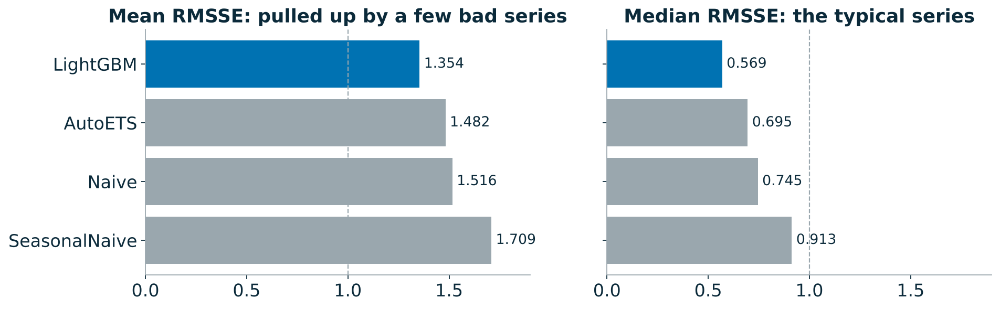

- **Last week beats last year** (Naive 1.52 vs SeasonalNaive 1.71): under two years of history, and promotions move around the calendar
- **Mean 1.35, median 0.57** for LightGBM: the typical item is forecast well; intermittent, mostly-zero items drag the mean up
- **Today's open questions**: is the GBDT strong because it is *global* or because it sees *covariates*? Can a neural net learn the features? At what cost? Does it respond to price the right way?

> **Takeaway:** Keep mean and median in view all day; the gap between them is the hard items.

<!--
Numbers are from the reference run on the full dataset (17,241 series). The open questions come back on the second-to-last slide with today's answers.
-->

---

<!-- _class: intuition -->

# Why one model for 17,000 series works

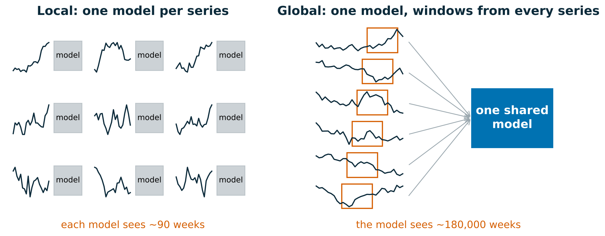

- A **local** model is a shop assistant who has watched one shelf (~90 weeks). A **global** model has watched the whole store (~180,000 weeks), so it recognises a promo spike even on a new item
- The catch: it learns **typical** behaviour. Per-window scaling and covariates adapt it to each item
- Today's models, all in `neuralforecast`: **N-HiTS / N-BEATS** (stacked MLPs, fast) and **TFT** (attention over covariates, 5–10× slower, optional in lab 01)

> **Takeaway:** One network trained on windows from every item pools evidence across the whole store.

<!--
The single most important idea of the morning. N-BEATS: Oreshkin et al. 2020, beat the M4 winner with pure deep learning. N-HiTS: Challu et al. 2023, cheaper and better at long horizons. TFT: Lim et al. 2021, variable selection plus attention; worth it with rich covariates and a GPU.
-->

---

<!-- _class: intuition -->

# N-BEATS as a relay race

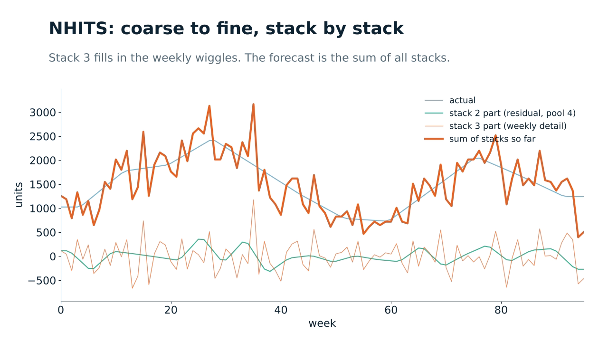

- Each block explains what it can of the input, **subtracts it**, and hands the rest on. The forecast is the sum of what every block carried
- **Interpretable** N-BEATS forces block 1 to be a trend and block 2 a season. Its sine waves repeat every 14 weeks (the horizon) or faster, so it **cannot** see a 52-week year
- **N-HiTS** runs the same relay on blurred (pooled) inputs, coarse to fine: cheaper and smoother

> **Takeaway:** Explain, subtract, pass on: the forecast is the sum of what each block carried.

<!--
The video shows N-HiTS doing exactly this on a real series: stack 1 draws 12 knots, stacks 2 and 3 add what is left. Residual stacking is just "explain, subtract, pass on". Lab 01 trains generic and interpretable N-BEATS side by side: the prior buys plots, not accuracy, on this data.
-->

---

<!-- _class: dense -->

# Neural global models vs GBDTs

| | GBDT (LightGBM via `mlforecast`) | Neural GFM (`neuralforecast`) |
|---|---|---|
| Features | **you build them**: lags, rolling stats, calendar | learned from the raw window (+ covariates) |
| Multi-step | recursive or one model per step | direct: whole horizon at once |
| Scaling | target transform per series | per-window scaler inside the model |
| Cost | minutes on CPU, robust defaults | longer, GPU helps; sensitive to lookback, lr, steps |
| Monotone constraints | **built in** | not available |
| Probabilistic | quantile objective or conformal | quantile / distribution losses |

**Evidence**: M5 (Walmart) was won by LightGBM ensembles; N-BEATS / N-HiTS shine on long, regular series.

> **Takeaway:** GBDT: you engineer the features, cheap to train. NN: learns them from windows, costs more to train and tune.

<!--
Costs to call out: GPU hours, feature pipelines, two different MLOps stacks. For a weekly batch job of 20k series both are cheap to serve; the real cost is training and tuning iterations.
-->

---

<!-- _class: intuition -->

# Scaling: compare shapes, not sizes

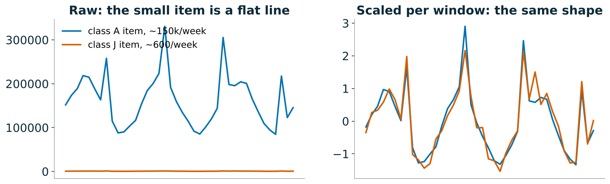

- Unscaled, a class J item (~600/week) is a flat line next to a class A item (~150k/week), and the network learns only the big ones
- Scaled **per window**, both show the same shape, which is what a global model needs to learn
- Same reason covariates must be **relative** (price index, discount depth): a raw price of 0.99 vs 39.99 says nothing about a discount

> **Takeaway:** Make items of every size look alike, and give networks relative, not raw, covariates.

<!--
NHITSx broke during preparation when fed raw sale prices: the network saw "expensive item" instead of "cheaper than usual". GBDTs instead transform the target per series (LocalStandardScaler).
-->

---

<!-- _class: intuition -->

# Evaluate like you forecast: rolling origins

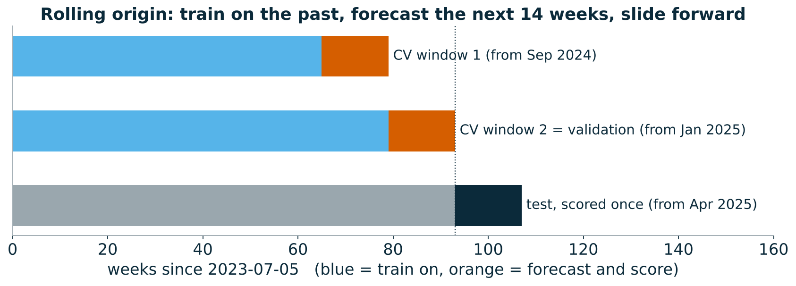

- Pretend it is an earlier date, train on what was known then, forecast 14 weeks, score, slide forward. **Never random K-fold**: it trains on the future
- Windows differ in difficulty, so compare models **on the same windows**
- NNs are stochastic: **re-run seeds** before believing a 1 % gap. `val_size` only pays off with early stopping or a search; otherwise it just drops the latest weeks

> **Takeaway:** Time-ordered windows, same windows for every model, and seed reruns before believing small gaps.

<!--
Lab 01 runs two rolling-origin windows: the scores differ a lot because the periods differ (one runs through Christmas). Lab 02 measures the seed noise floor.
-->

---

<!-- _class: intuition -->

# The loss decides which number you get

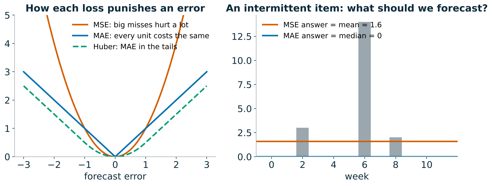

- Train on **MSE** and the model aims for the **mean**; on **MAE**, the **median**; on pinball loss, a **quantile**
- For an item that sells nothing most weeks, the median is **0**: an MAE model may forecast zero and stock nothing
- Pick the loss for the decision (volume planning vs avoiding stock-outs), then check on validation. In lab 02, MAE beat MSE because MSE chases promo spikes

> **Takeaway:** MSE → the mean, MAE → the median, pinball → a quantile.

<!--
Ask: which number do you want for a slow mover that sells 0, 0, 3, 0, 0, 0, 14? Poisson/Tweedie losses are the other option for count data.
-->

---

<!-- _class: lab -->

# Default training with GFMs · `01` (20 min)

1. **Wrangle**: polars panel → pandas long format; check gaps, duplicates, weekday
2. **Split**: 2-fold rolling-origin CV on train to see how much the score moves between periods
3. **Train with defaults**: NHITS · N-BEATS generic · N-BEATS interpretable · DLinear · (TFT optional)
4. `bc.record(...)` → leaderboard

**Discuss**: did decomposition help? How does fit time compare with LightGBM?

<!--
Expected on CPU (500 steps, all series): NHITS about 1.39, both N-BEATS about 1.41, DLinear about 1.59; LightGBM 1.35.
-->

---

<!-- _class: result -->

# Lab 01: what we found

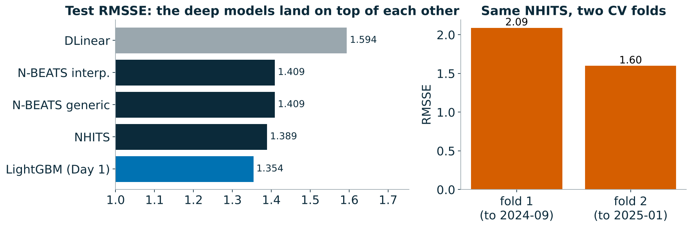

- **The deep models tie each other, a little behind LightGBM** (1.39–1.41 vs 1.35); DLinear, a linear model, is clearly worse (1.59)
- **Interpretable ≈ generic** (1.409 vs 1.409): the trend/season prior buys plots, not accuracy
- **The period matters more than the model**: the same NHITS scores 2.09 on the fold through Christmas and 1.60 on the next. Cost: 19–27 s per fit vs about 6 s for LightGBM

> **Takeaway:** With defaults, neural global models trail LightGBM slightly at 3–5× the fit time.

<!--
The two folds are different periods, not different seeds, so this is about how hard a window is. A 0.03 gap on one window may flip on the next.
-->

---

<!-- _class: lab -->

# Hyperparameter optimisation · `02` (30 min)

1. **One at a time**: vary lookback, learning rate, loss, width; score on the **validation** window
2. **Noise floor**: refit the default with 3 seeds; a knob that does not clearly beat the seed spread is not a finding
3. **Optuna TPE** search with `AutoNHITS` over the knobs that mattered, then refit and score once

*TPE in plain words: after a few random tries, propose settings that look like the good trials and unlike the bad ones.*

<!--
If the room is short on time, cut the sweep to input_size, learning_rate and loss. RUN_ALL=True adds scaler_type, max_steps and n_blocks.
-->

---

<!-- _class: result -->

# Lab 02: what we found

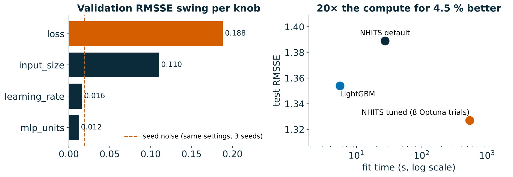

- **Noise floor**: same settings, three seeds → validation RMSSE moves by **0.02**
- **Two knobs beat it**: the loss (MSE 1.80 vs MAE 1.61) and the lookback (56 weeks 1.54 vs 14 weeks 1.65); width and learning rate are inside the noise
- **Optuna**: 8 trials, 540 s, test 1.389 → 1.327. **20× the compute for 4.5 %**, enough to pass LightGBM (1.354), mostly from the 56-week lookback the sweep had already found

> **Takeaway:** Get the loss and the lookback right, check gains against seed noise, then stop tuning.

<!--
fANOVA puts 98 % of the importance on the learning rate, but that is within the ranges searched, from 8 trials; the one-at-a-time sweep is the more honest picture. Lab 03 reuses the 56-week lookback with default everything else: NHITS_noexog (1.318) lands within seed noise of the tuned NHITS (1.327), so the lookback is the whole gain, and NHITSx (1.303) adds the covariates on top.
-->

---

<!-- _paginate: false -->

# Break · 15 min

---

<!-- _class: lab -->

# Exogenous variables and responsiveness · `03` (30 min)

- **Future** covariates the model may use: planned price index, promo flag, discount depth; **static**: log mean sales, share of zero / promo weeks
- **Accuracy** asks "did you predict what happened?"; **responsiveness** asks "if we changed the price, would you predict the right thing?"
- **What-if check**: shift price −25 % … +25 %, switch promos on/off, re-forecast. The price curve should slope down, promo lift should be positive and plausible
- LightGBM can force the sign with `monotone_constraints`; a neural net cannot

<!--
Confounding: retailers cut prices when they expect high demand, so a model can learn "cheaper → fewer sales". Ice cream and sunburn rise together; banning ice cream does not prevent sunburn. Elasticity −2 means a 10 % price cut gives about 20 % more units.
-->

---

<!-- _class: result -->

# Lab 03: what we found

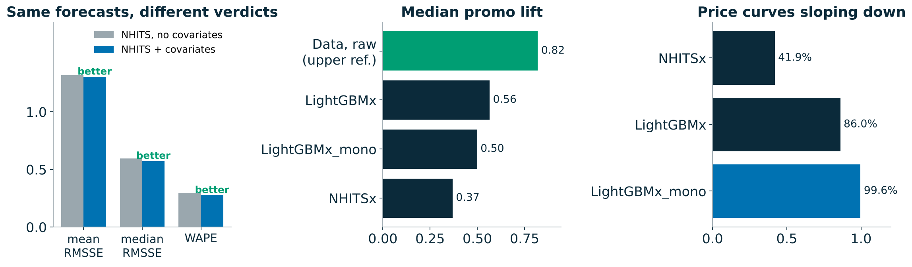

- **LightGBM needs covariates**: 1.37 with them, 1.52 without (no better than Naive)
- **NHITS: small on the mean, clear elsewhere.** Mean 1.32 → 1.30, better on 56 % of series, median 0.60 → 0.57, WAPE 0.29 → 0.28. On intermittent items the covariates are noise and hold the mean back
- **Responses**: direction right (99.6 % of monotone LightGBM curves slope down), size timid: promo lift +37 % to +57 % vs +82 % raw in the data (an upper bound)

> **Takeaway:** Judge covariates on more than one summary, and check the size of the response, not just its sign.

<!--
NHITSx has the best mean, median and WAPE of the lab and the most timid promo response (+37 %). Accuracy and responsiveness are different questions. The promo scenario switches on the flag with the item's usual discount, so it compares like with like.
-->

---

<!-- _class: intuition -->

# Foundation models: the well-travelled forecaster

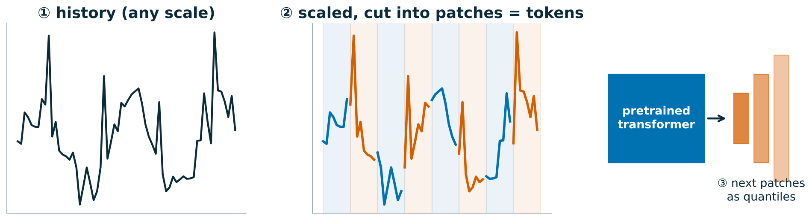

- **Recipe of a language model**: scale the history, cut it into patches ("words"), let a transformer predict the next patches as quantiles, after pretraining on millions of series
- **Zero-shot** = a consultant who has seen every industry but not your shop; **fine-tuned** = the same consultant after a week of induction, better on your quirks but now you pay for training
- **Chronos-2** and **TabPFN-TS** read covariates (your promo calendar); with ≤ 93 weeks of history, context length is not the bottleneck, the prior is

> **Takeaway:** Try zero-shot first; fine-tune only when validation shows a clear gain worth the GPU time.

<!--
Other models: Chronos-Bolt (Amazon), TimesFM (Google), Moirai (Salesforce); timecopilot wraps them behind one forecast(df, h, freq) API. Benchmark caveat: public test sets may be in the pretraining data. Measure seconds per 1,000 series: foundation models cost more per forecast than LightGBM or NHITS.
-->

---

<!-- _class: lab -->

# Foundation models: tune or not? · `04` (30 min)

1. **Zero-shot** via `timecopilot`: Chronos-2 with and without covariates, TimesFM 2.5, TabPFN-TS on a subset
2. **Fine-tune** Chronos-2; compare on the **validation** window first
3. Measure **seconds per 1,000 series** and fill in the decision table

| | Accuracy gain vs tuned NHITS / LightGBM | Cost | Decision |
|---|---|---|---|
| zero-shot | ? | ? | |
| fine-tuned | ? | ? | |

<!--
Make sure the room downloaded the weights before the break (first two cells: Chronos-2 0.5 GB, TimesFM 1 GB). All 17,241 series take about 2 hours on a 4-core CPU (TimesFM is more than half of it), so on a laptop set FM_N_SERIES=1000 (about 12 minutes). TabPFN-TS only runs with a GPU.
-->

---

<!-- _class: result -->

# Lab 04: what we found

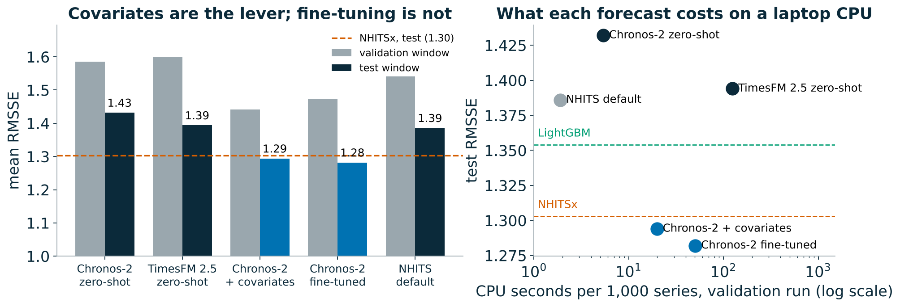

- **Zero-shot is already a baseline to beat**: Chronos-2 and TimesFM 2.5 agree (1.59 and 1.60 on validation), level with a default NHITS, with no training
- **Covariates in context are the lever**: 1.59 → 1.44 on validation, mostly on erratic, promo-driven items. On test, 1.29 beats NHITSx (1.30) and LightGBM (1.35), median 0.51 vs 0.57
- **Fine-tuning fails the validation test** (1.47 vs 1.44) and gains 0.01 on test, half the seed noise, for 10 more CPU minutes

> **Takeaway:** Chronos-2 with covariates was the best single model of the day; fine-tuning added 0.01, inside the noise, so decide with validation, not hope.

<!--
Cost on a 4-core CPU per 1,000 series (validation run): Chronos-2 5 s zero-shot, 20 s with covariates, about 50 s fine-tuned (150 LoRA steps); TimesFM 120 s; NHITS trains and forecasts in about 2 s. Intermittent and lumpy items barely move with any model. The ensembles in Lab 07 now include the foundation models.
-->

---

<!-- _class: lab -->

# Hierarchy and coherence · `05` (20 min)

- Forecast every level separately and the items will not add up to the department, like a budget whose lines disagree with its total
- **BottomUp** trusts the items, **TopDown** trusts the total, **MinTrace** weighs each level by how reliable it has been
- Run the **coherence check**, then compare accuracy level by level

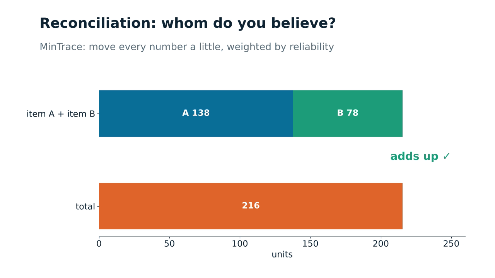

<!--
The video morphs incoherent base forecasts into BottomUp, TopDown and MinTrace. Total → departments → classes → subclasses → items from hierarchy.csv, AutoETS base forecasts, six reconcilers. MinTrace variants: ols weighs every node equally, wls_struct by how many items sit below, wls_var by each node's own past error variance (mint_shrink adds the covariances, too big for 19,000 nodes). Ask: who reads which level? Buyers read items, finance reads departments.
-->

---

<!-- _class: result -->

# Lab 05: what we found

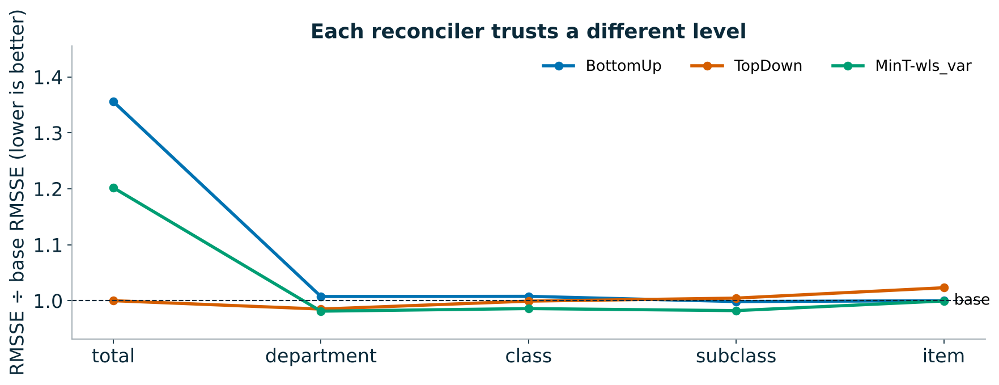

- **BottomUp**: items unchanged, total 36 % worse; **TopDown**: total untouched, items 2 % worse
- **MinT-wls_var** (each node's own error variance): about 2 % better in the middle levels, ties the base at the items (1.400 vs 1.402), 20 % worse on the store total
- **Weights matter**: MinT-ols is 4–24× worse below the total. At 19,334 nodes the dense MinT does not fit in memory: use the sparse reconcilers

> **Takeaway:** MinT with per-node variances gives coherence almost for free; the weights are what make it work.

<!--
Ratios are relative to the incoherent base forecasts, scaled by the 1-step naive error. MinT-ols weighs a 600-unit item like a department selling millions. mint_shrink needs a dense 19,000 × 19,000 covariance, so it is not run at this size; MiddleOut (from the class level) is coherent and sits between BottomUp and TopDown.
-->

---

<!-- _class: intuition -->

# Scoring uncertainty: calibrated, then sharp

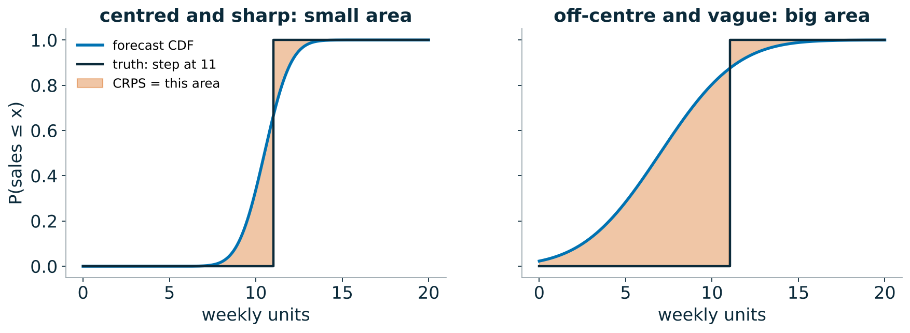

- **Calibration**: an 80 % interval should contain the truth 80 % of the time. **Sharpness**: among calibrated forecasts, narrower is better. Coverage alone is not a score: [0, ∞) always covers
- **CRPS** = the area between the forecast CDF and the step at the actual value: small when centred and confident. For a single number it equals the absolute error
- **Interval score**: width plus a penalty for every miss. Scale both per series before averaging

> **Takeaway:** Judge intervals by calibration first, then sharpness, with a proper score.

<!--
Proper score: you cannot improve your expected score by reporting anything other than what you believe. Pinball loss for the 90 % quantile: being 1 unit too low costs 9 times as much as 1 unit too high.
-->

---

<!-- _class: intuition -->

# Conformal: be as wrong as you were before

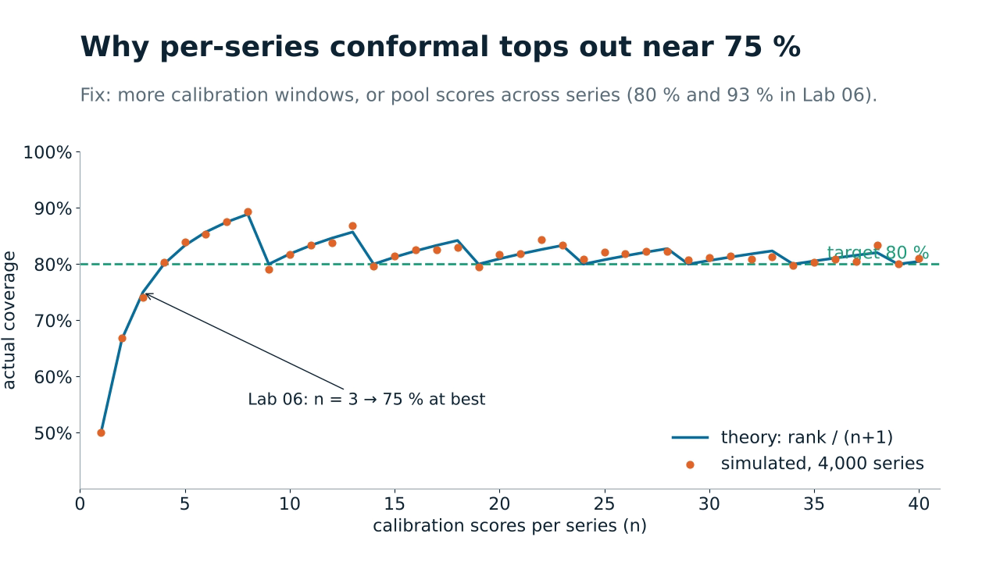

- Collect the model's errors on held-out past windows, and put **that much** around every new forecast. Works for **any** model
- The guarantee needs enough errors: at least ⌈(n+1)(1−α)⌉ ≤ n, i.e. **19 for a 95 % interval**
- With 3 windows per series, a 95 % interval is just the largest of 3 errors, and a new error beats it 1 time in 4. **Pooling** scale-free errors across series fixes this

> **Takeaway:** Conformal turns past errors into intervals for any model, given enough past errors.

<!--
The video sweeps n from 1 to 40: coverage is capped at n/(n+1) until n ≥ 4 for 80 %. In the stack: PredictionIntervals (mlforecast), ConformalIntervals (statsforecast), MQLoss in neuralforecast. Not guaranteed: coverage per series, per promo week, or under drift. Extensions: CQR (conformalise quantile intervals), adaptive conformal for drift.
-->

---

<!-- _class: result -->

# Demo 06: what we found

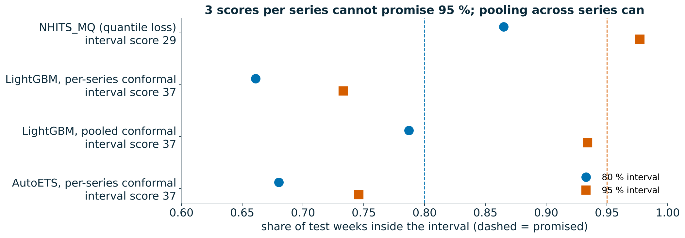

- **NHITS with a quantile loss**: 87 % for a promised 80 %, still the best scores by far (CRPS 2.7 vs about 3.7): widths that follow each item and week
- **Per-series conformal**: 66–68 % for 80 %, 73–75 % for 95 %, the 3-window cap at work
- **Pooled conformal** keeps the promise (79 %, 93 %) but scores no better: the same relative width for every item

> **Takeaway:** A conformal promise needs enough past errors, and honest width is not yet useful width.

<!--
Fixes that add shape and keep the guarantee: calibrate per class, or conformalise the quantile model (CQR).
-->

---

<!-- _class: lab -->

# Model selection and ensembling · `07` (20 min)

- Treat every series as a **match** between two models: lower RMSSE wins
- **Win rate**, **Bradley–Terry** and **Elo** turn the matches into ratings; +100 points ≈ 64 % chance to win a series
- Slice by **volume** (class A–J) and **shape** (smooth / erratic / intermittent / lumpy)
- **Ensembles** chosen on half the series, scored on the other half

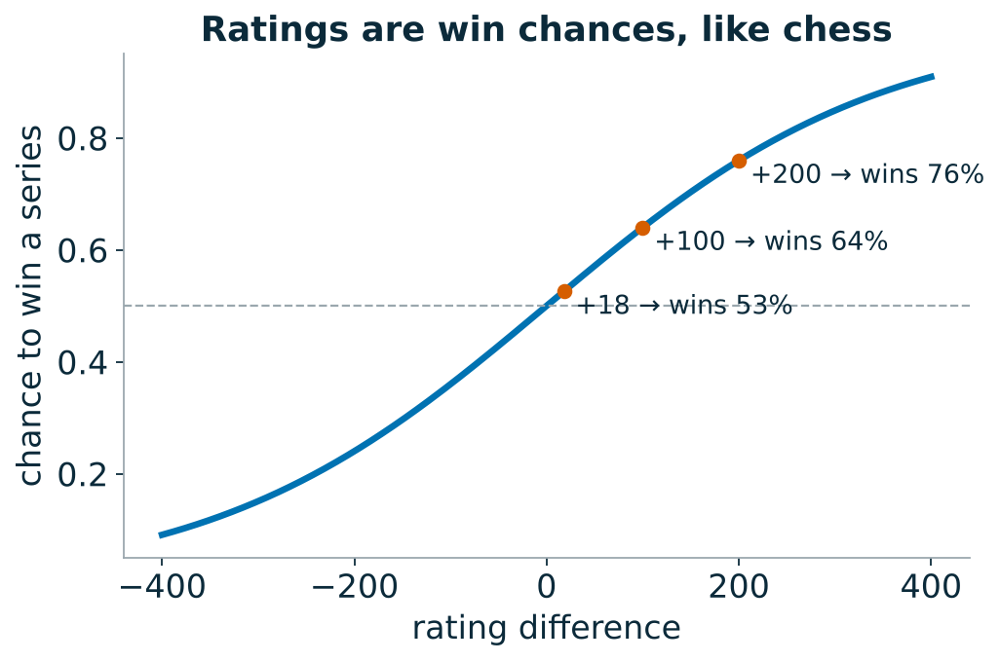

<!--
Win rates show who usually wins; mean RMSSE shows who avoids disasters. Demand types use Syntetos–Boylan cut-offs: ADI (weeks between sales) 1.32 and CV² of non-zero sales 0.49, computed from the training weeks.
-->

---

<!-- _class: result -->

# Lab 07: what we found

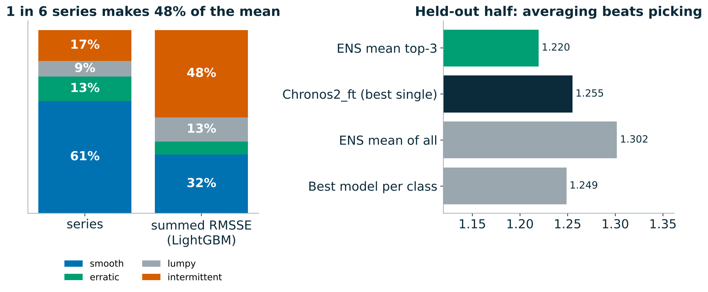

- **Chronos-2 with covariates leads**: fine-tuned has the lowest mean, zero-shot wins the most duels (68 %), then NHITSx; but on intermittent items (17 % of series, 46–49 % of the summed RMSSE) the NHITS models without covariates win
- On the **held-out half**, the top-3 average (Chronos-2 ×2 + NHITSx) beats every single model by about 3 % (1.220 vs 1.255)
- Picking the best model **per class** lands in between (1.249): **averaging is the safer default**

> **Takeaway:** No model wins everywhere; averaging a few good models from different families is the safest pick.

<!--
On the leaderboard the top-3 average scores 1.164, but half the series helped choose it, so quote the held-out comparison: 1.220 vs 1.255 for the best single model (Chronos2_ft) and 1.330 for Day 1's LightGBM on the same half. Without the foundation models the gain was about 1 % (three NHITS variants); mixing model families is what makes averaging pay. Lab 07 also prints the full metric suite and a rank table: LightGBM over-forecasts total volume by 11 %, and Chronos-2 drops to 10th–12th on intermittent items. Run the last cells of 07 to show the final standings chart.
-->

---

<!-- _class: result -->

# This morning's questions, answered

| Question | What today's numbers say |
|---|---|
| **Global** or **covariates**? | **Covariates** for LightGBM (1.52 without them). NHITS without covariates (1.32) already beats LightGBM (1.35) |
| Can a neural net learn the features? | **Mostly yes**, from the raw window |
| What does it cost? | 19–27 s per neural fit vs about 6 s; tuning 540 s for 4.5 %; zero-shot Chronos-2 about 6 min on a CPU |
| Does it **respond to price** correctly? | **Direction yes, size timid**: +37 % to +57 % vs +82 % raw |
| Best single model? | **Chronos-2 with covariates**: 1.28 fine-tuned, 1.29 zero-shot (the gap is noise) vs 1.30 for NHITSx and 1.35 for LightGBM |
| Best of the day? | The **average of the top 3**: 1.22 on the held-out half vs 1.26 for the best single model (Chronos2_ft) |

<!--
Close the loop: go back to the open questions from the recap and read this table out.
-->

---

<!-- _class: summary -->

# Take home

| Block | The one idea |
|---|---|
| **Global deep models** | One model learns from every item; NN vs GBDT trades feature work for training cost |
| **Training and tuning** | Get the loss and lookback right, check gains against seed noise, then stop |
| **Covariates** | Accuracy is not responsiveness: check what the model does when price or promotion changes |
| **Foundation models** | A strong zero-shot baseline; fine-tune only when validation says so |
| **Hierarchy and uncertainty** | Reconcile with good weights; intervals need enough calibration errors |
| **Selection** | Look beyond the mean, then average the best few models |

<!--
5 minutes. Announce the top three on the room's leaderboard, then read this table as the take-home.
-->
