<!-- _paginate: false -->

# Time Series Bootcamp · Day 2
## Deep learning, foundation models and advanced topics

Packt Nov 2026 · Weekly retail sales · 18,692 products · one supermarket
`neuralforecast` · `statsforecast` · `mlforecast` · `timecopilot` · `polars`

<!--
Welcome back. Yesterday: baselines, evaluation, gradient boosting. Today: neural global models, tuning, covariates, foundation models, hierarchy, uncertainty, and how to pick and combine models. Same data, same split, same leaderboard.
-->

---

<!-- _class: dense -->

# Today

| Time | Segment | Type | Notebook |
|---|---|---|---|
| 0:00 | Recap and handoff: Day 1 leaderboard | talk | `00` |
| 0:10 | Deep learning for global modelling | talk | |
| 0:25 | ML vs NNs: transforms, features, parameters, evaluation, losses | talk | |
| 0:45 | Default training with GFMs | **lab** | `01` |
| 1:05 | Hyperparameter optimisation | **lab** | `02` |
| 1:35 | *Break* | | |
| 1:50 | Exogenous variables and responsiveness | **lab** | `03` |
| 2:20 | Foundation models | talk | |
| 2:40 | Foundation models: tune or not? | **lab** | `04` |
| 3:10 | Hierarchy and coherence | **lab** | `05` |
| 3:30 | Uncertainty: scoring rules and conformal | talk + demo | `06` |
| 3:50 | Model selection and ensembling | **lab** | `07` |
| 4:10 | Final standings | | `07` |

> **Takeaway:** Six labs feed one leaderboard: every model is judged on the same 17,241 items and the same 14 test weeks.

<!--
255 minutes. Every lab runs on all 17,241 eligible series by default on a laptop CPU; on a slow machine set BOOTCAMP_N_SERIES=2000 for a stratified sample. Anyone with a GPU can raise BOOTCAMP_MAX_STEPS to 1500.
-->

---

<!-- _class: summary -->

# Day 2 in one slide

| Block | The one idea to take home |
|---|---|
| **Global deep models** | One model learns from every item; NN vs GBDT is a trade of feature work against training cost, not magic |
| **Training and tuning** | Get the loss and the lookback right, measure the noise floor, then stop tuning |
| **Covariates** | Accuracy is not responsiveness: check what the model does when price or promotion changes |
| **Foundation models** | A strong zero-shot baseline for little effort; fine-tune only when validation says so |
| **Hierarchy and uncertainty** | Forecasts must add up across levels, and intervals must keep their promise |
| **Selection** | Look at win rates and segments, then average the best few models |

<!--
Show this at the start and come back to it at the end. Every later "Summary" slide is one row of this table, filled in with today's numbers.
-->

---

# Recap: the rules of the game

```
2023-07-05 ────────── train ────────── 2025-04-16 ─── test (14 weeks) ─── 2025-07-16
                               valid (last 14 train weeks) ┘
```

- **Target**: weekly `sales_units` per item · **horizon** 14 weeks · weeks start on **Wednesday** (`W-WED`)
- **Score**: mean **RMSSE**, scaled by each series' in-sample 52-week seasonal-naive error
- Also: median RMSSE, MASE, sMAPE, **WAPE** (volume-weighted), **fit time**
- All 17,241 eligible series in every lab (`bootcamp.load_panel()`)
- Every lab ends with `bc.record(...)` → one row per model in `results/day2/leaderboard.csv`

> **Takeaway:** Same data, same split, same score as Day 1, so every number today is comparable.

<!--
Run notebook 00 live. It rebuilds the Day 1 references (Naive, SeasonalNaive, AutoETS, LightGBM) so the leaderboard is never empty. If participants kept results/day1/leaderboard.csv, it is shown too.
-->

---

<!-- _class: intuition -->

# Reading RMSSE in one picture

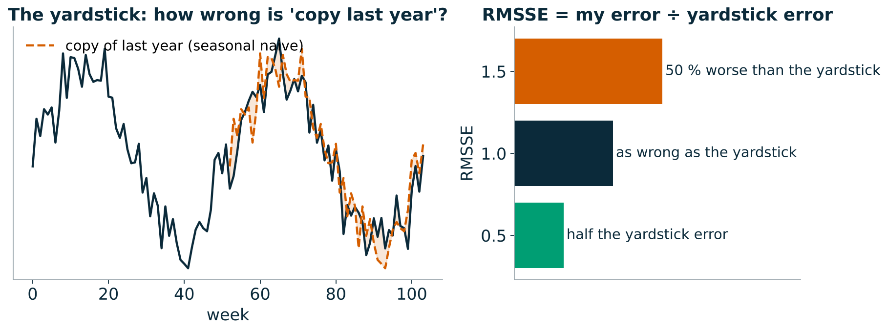

- **The yardstick** is "copy the same week last year", measured on each item's own history. RMSSE = my error ÷ the yardstick's error
- **0.6** means 40 % smaller errors than the yardstick. **Scale-free**: a 600-unit item and a 150k-unit item count the same
- **Above 1 is normal out of sample**: the yardstick was measured on the past, our forecast is judged on a future it has not seen

> **Takeaway:** Below 1 beats the yardstick. Scale-free, so it averages fairly across items of any size.

<!--
Intuition first, formula never. Ask the room: if RMSSE were 1.0 for every item, what would that mean? (We are exactly as good on the future as copying last year was on the past.) Make sure everyone can read a leaderboard number before the labs start.
-->

---

# Recap: Day 1 leaderboard

<div class="cols">
<div>

**What we learned**
- Slow movers (class **J**) are hard for every model: mean RMSSE ≈ 1.4–1.8 against ≈ 0.5–1.0 for classes B–I
- A *global* GBDT with lags, calendar and price/promo features was the strongest model
- Mean RMSSE treats every series equally; class **J** (slow movers) is ~2/3 of series

</div>
<div>

**Open questions for today**
- Is the GBDT strong because it is **global**, or because it sees **covariates**?
- Can a neural net learn the features we hand-built?
- What does it cost?
- Does any of it **respond to price** the right way?

</div>
</div>

> **Takeaway:** Today's thread: is the GBDT good because it is global, or because it sees prices and promotions?

<!--
Show the leaderboard printed at the end of notebook 00. Ask the room the two handoff questions at the end of the notebook.
-->

---

<!-- _class: result -->

# Day 1 in one picture

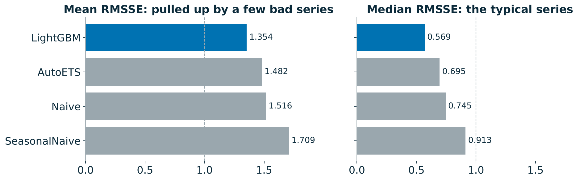

- **Last week beats last year** (Naive 1.52 vs SeasonalNaive 1.71): with under two years of history and promotions that move around the calendar, "the same week last year" is a weak guide
- **Mean 1.35, median 0.57**: the typical item is forecast well; a minority of intermittent, mostly-zero items drags the mean up. Keep both numbers in view all day

<!--
Numbers are from the reference run on the full dataset (17,241 series). Your room's numbers will be close but not identical. The mean/median gap comes back in lab 07, where the 17 % of series that are intermittent turn out to make close to half of the mean.
-->

---

<!-- _class: dense -->

# Deep learning for global modelling

**Global model** = one set of parameters shared by all series, trained on windows sampled from every series.

- Learns patterns that recur **across** series (promo spikes, seasonal shapes, launch curves)
- Works for **short and new** series that a local model cannot fit
- Training cost scales with **windows sampled**, not with number of series × models

The three architectures we use today, all in `neuralforecast`:

| | N-BEATS | N-HiTS | TFT |
|---|---|---|---|
| Core | stacked MLP blocks, backcast/forecast residuals | N-BEATS + multi-rate pooling + interpolation | LSTM encoder + attention + variable selection |
| Decomposition | optional (trend/seasonality basis) | implicit, by frequency band | none |
| Covariates | future + static (NBEATSx) | future + historic + static | future + historic + static, gated |
| Speed | fast | fastest | slow |

> **Takeaway:** One network trained on windows from every item: it pools evidence across the whole store.

<!--
15-minute segment. Emphasise: these are all window-based global MLPs or seq2seq models, not "magic". N-BEATS: Oreshkin et al. 2020; published after the M4 competition, it beat the M4 winner's accuracy with a pure deep-learning model and no hand-made features. N-HiTS: Challu et al. 2023, cheaper and better at long horizons. TFT: Lim et al. 2021, interpretability via variable selection weights and attention.
-->

---

<!-- _class: intuition -->

# Why one model for 17,000 series works

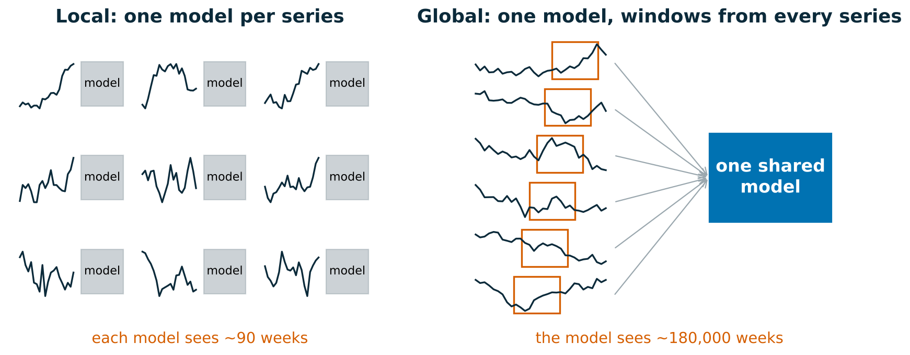

- A **local** model is a shop assistant who has only ever watched one shelf. A **global** model has watched the whole store, so it recognises a promo spike it has seen thousands of times, even on a brand-new item
- The catch: it learns **typical** behaviour. Per-window scaling and covariates are how it adapts to each item

> **Takeaway:** Global models learn typical shapes from many items, then adapt through scaling and covariates.

<!--
This is the single most important idea of the morning. The data per local model is ~90 weeks; the global model sees about 180,000 weeks. Everything else (N-BEATS, N-HiTS, TFT, LightGBM with lags) is a different way of learning from that pooled data.
-->

---

<!-- _class: dense -->

# N-BEATS in one slide

- Input: the last `input_size` values · output: the next `h`
- Each **block**: MLP → coefficients θ → **backcast** (explains the input) and **forecast**
- Next block sees the **residual** of the input: doubly residual stacking
- **Generic** stack: θ maps through a learned linear basis
- **Interpretable** stack: θ are coefficients of a **polynomial trend** and **Fourier seasonality** basis
  → the forecast is a sum of trend + seasonality components you can plot
- Caveat: the seasonality basis only holds sine waves with periods up to the horizon (14 weeks), so it **cannot** represent a 52-week year

**N-HiTS** adds max-pooling on the input (each stack looks at a different time resolution) and predicts a few points that are interpolated to the horizon: fewer parameters, faster, smoother.

> **Takeaway:** Stacks of plain MLPs, each explaining what the previous one left over. N-HiTS does it faster and smoother.

<!--
Lab 01 trains both generic and interpretable N-BEATS so the room can see whether the decomposition prior helps on two years of weekly data. In the reference run it made no difference to accuracy (1.409 vs 1.409): there are only ~1.8 seasonal cycles to learn from.
-->

---

<!-- _class: intuition -->

# N-BEATS as a relay race

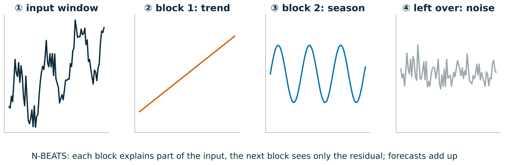

- Each block is a runner: it explains the part of the input it can, **subtracts it**, and hands the rest to the next runner. The forecast is the sum of what every runner carried
- **Interpretable** N-BEATS forces runner 1 to be a trend and runner 2 a season, so you can plot each piece
- **N-HiTS** runs the same relay, but runners look at blurred (pooled) inputs, from coarse to fine: cheaper and smoother

> **Takeaway:** Explain, subtract, pass on: the forecast is the sum of what each block carried.

<!--
If people remember one picture of N-BEATS, make it this one. Residual stacking is just "explain, subtract, pass on". The interpretable variant is the same machine with a constraint on what each block may output.
-->

---

# Temporal Fusion Transformer in one slide

- **Variable selection networks** weigh each covariate per time step
- **Static covariate encoders** condition everything on item attributes
- LSTM **encoder–decoder** for local patterns, **multi-head attention** for long-range ones
- Natively outputs **quantiles**
- Interpretable: variable importances and attention patterns

In plain words: a **committee chair** (variable selection) decides which inputs get a say each week, and **attention** lets the model quote the most relevant past weeks.

Cost: 5–10× slower to train than N-HiTS on a CPU; benefit grows with **rich, informative covariates** and long histories.

> **Takeaway:** Reach for TFT when you have many informative covariates and the compute to train it.

<!--
Mention that TFT is in lab 01 behind RUN_TFT=False because on a CPU it does not fit in the 20-minute slot.
-->

---

<!-- _class: dense -->

# Neural global models vs GBDTs

| | GBDT (LightGBM via `mlforecast`) | Neural GFM (`neuralforecast`) |
|---|---|---|
| Features | **you build them**: lags, rolling stats, calendar | learned from the raw window (+ covariates) |
| Multi-step | recursive or one model per step | direct: whole horizon at once |
| Scaling | target transforms per series | per-window scaler inside the model |
| Training cost | minutes on CPU | minutes to hours, GPU preferred |
| Inference cost | cheap, CPU | cheap per batch, GPU helps |
| Tuning burden | moderate, robust defaults | sensitive: lookback, lr, steps |
| Monotone constraints | **built in** | not available |
| Probabilistic | quantile objective or conformal | quantile / distribution losses |

**Evidence**: M5 (Walmart) was won by LightGBM ensembles; N-BEATS / N-HiTS shine on long, regular series and many horizons.

> **Takeaway:** GBDT: you engineer the features, cheap to train. NN: learns them from windows, costs more to train and tune.

<!--
Costs to call out: GPU hours, engineering time for feature pipelines, MLOps (two very different stacks), and serving latency. For a weekly batch job of 20k series, both are cheap to serve; the real cost is training and tuning iterations.
-->

---

<!-- _class: dense -->

# ML vs NNs (1/3): transforms and features

**Transformations**
- GBDTs: transform the **target** per series (`LocalStandardScaler`, `log1p`, differences) and invert after prediction
- NNs: scale **each input window** (`scaler_type="robust" | "standard" | "revin"`); one global scaling fails when series differ by 5 orders of magnitude (class A ≈ 150k units/week, class J ≈ 600)
- Zero-heavy series: log transforms need an offset; robust scaling needs non-zero IQR

**Feature engineering**
- GBDTs need **lags, rolling means, calendar, price features** spelled out
- NNs learn lags from the window but still need **covariates** (price, promo) and benefit from **calendar** features at weekly resolution
- Hierarchy ids: categorical features for GBDTs; for NNs use embeddings or numeric **static covariates** (log mean sales, share of zero weeks, share of promo weeks). A raw id fed as a number is meaningless

> **Takeaway:** Make items of every size look alike (scaling) and give networks relative, not raw, covariates.

<!--
20-minute segment total for the three ML vs NN slides. Live: show `bootcamp._add_price_features` – these relative price features are shared by LightGBM and NHITSx in lab 03.
-->

---

<!-- _class: intuition -->

# Scaling: compare shapes, not sizes

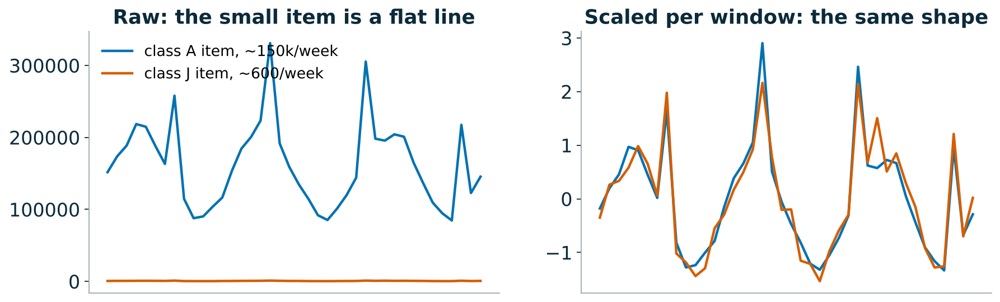

- Unscaled, a class J item (~600/week) is a flat line next to a class A item (~150k/week), and the network learns only the big ones
- Scaled per window, both show the **same shape**: what the global model actually needs to learn. The forecast is scaled back afterwards
- Same reason covariates must be **relative** (price index, discount depth): a raw price of 0.99 vs 39.99 says nothing about a discount

> **Takeaway:** Networks learn shapes; per-window scaling makes a 600-unit item and a 150k-unit item comparable.

<!--
This is why NHITSx broke during preparation when we fed raw sale prices: the network saw "expensive item" instead of "cheaper than usual". Lab 03 uses scale-free covariates and scaler_type="standard".
-->

---

<!-- _class: dense -->

# ML vs NNs (2/3): parameters and evaluation

**What you tune**

| GBDT | NN |
|---|---|
| `num_leaves`, `learning_rate`, `n_estimators` | `input_size` (lookback), `learning_rate`, `max_steps` |
| `min_data_in_leaf`, regularisation | `scaler_type`, `loss`, `batch_size` |
| which lags / windows | architecture size (rarely matters) |

**How you evaluate**
- Both: temporal holdout + **rolling-origin cross-validation**, never random K-fold
- NNs: a **validation window** (`val_size=h`) only helps with early stopping (`early_stop_patience_steps`) or a search; otherwise it just removes the latest weeks from training
- NNs are **stochastic**: re-run with 3 seeds before believing a 1 % difference
- Report **fit time** next to accuracy

> **Takeaway:** Evaluate on time-ordered windows, report fit time, and re-run seeds before believing small gaps.

<!--
Seed variance is the thing most people skip. Lab 01's two CV folds show how much the test period matters; lab 02 refits the same model with three seeds to measure the noise floor (about 0.01 RMSSE here).
-->

---

<!-- _class: intuition -->

# Rolling-origin evaluation: back-testing

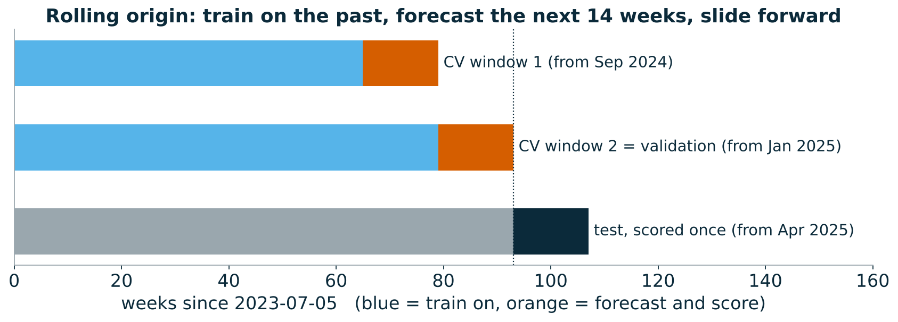

- Pretend it is an **earlier date**, train on what was known then, forecast the next 14 weeks, score, then slide forward
- **Random K-fold** would train on the future to predict the past: scores look great and mean nothing
- Each window is a different season, so scores differ between windows; compare models **on the same windows**

> **Takeaway:** Evaluate the way you will forecast: from the past into the future, one window at a time.

<!--
Lab 01 runs two rolling-origin windows on the training data. The two windows give very different scores, which is about the periods, not the model.
-->

---

<!-- _class: dense -->

# ML vs NNs (3/3): loss functions

| Loss | Estimates | Use when |
|---|---|---|
| MSE | mean | metric is RMSE/RMSSE, few outliers |
| MAE | median | metric is MAE/MASE, robust to spikes; **median of intermittent series can be 0** |
| Huber | between the two | promo spikes + RMSE-type metric |
| Poisson / Tweedie | mean of counts | intermittent, non-negative demand (GBDT objective; `DistributionLoss` in NNs) |
| Quantile / MQLoss | quantiles | intervals, asymmetric costs (stock-outs vs waste) |

**Match the loss to the metric and the decision, then check.** In theory MSE suits an RMSE-type score; in Lab 02, MAE still won, because promo spikes make MSE training chase outliers.

> **Takeaway:** The loss chooses what the model estimates. Choose it for the decision, then verify on validation.

<!--
Lab 02 includes loss in the sensitivity sweep so participants can see how much it matters on this data.
-->

---

<!-- _class: intuition -->

# The loss decides which number you get

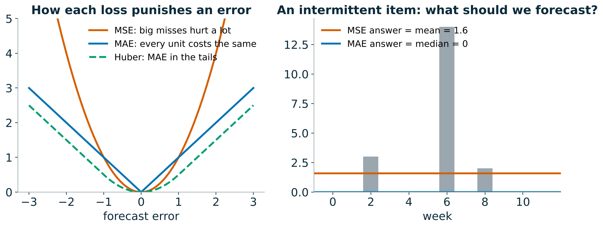

- Train on **MSE** and the model aims for the **mean**; train on **MAE** and it aims for the **median**
- For an item that sells nothing most weeks, the median is **0**: an MAE model may happily forecast zero, and stock nothing
- Pick the loss for the **decision**: the mean for volume planning, a high quantile for avoiding stock-outs

> **Takeaway:** MSE → the mean, MAE → the median, pinball → a quantile.

<!--
Ask: which number do you want for a slow mover that sells 0, 0, 3, 0, 0, 0, 14? The answer depends on what you do with it, which is the point. Lab 02 shows the loss is the most influential knob on this data.
-->

---

<!-- _class: summary -->

# Summary: neural global models

- **Global** beats local here because 17,000 items share patterns that 90 weeks of one item cannot show
- N-BEATS / N-HiTS are **residual stacks of MLPs**; TFT adds attention and variable selection for rich covariates
- Versus a GBDT you trade **feature engineering** for **training cost** and tuning sensitivity
- Two things matter more than the architecture: **scaling** (shapes, not sizes) and the **loss** (which number you get)
- Evaluate with **rolling origins**, never random folds, and report **fit time** next to accuracy

<!--
Read this out before the first lab. The next three labs test each claim on our data.
-->

---

<!-- _class: lab -->

# Default training with GFMs · `01` (20 min)

1. **Wrangle**: polars panel → pandas long format; check gaps, duplicates, weekday, scale spread
2. **Split**: train / valid / test; 2-fold rolling-origin CV on train to see how much the score moves between periods
3. **Train with defaults**: NHITS · N-BEATS generic · N-BEATS interpretable (trend + seasonality) · DLinear (moving-average decomposition) · TFT optional
4. `bc.record(...)` → leaderboard

**Discuss**: did decomposition help? How does fit time compare with LightGBM?

> **Takeaway:** Library defaults, same split: how close do neural models get to LightGBM, and at what cost?

<!--
Expected result on CPU with defaults (500 steps): neural models land between LightGBM (1.35) and AutoETS (1.48); NHITS at about 1.39, DLinear worse than both at about 1.59. The results slide that follows has the reference numbers and how to read them.
-->

---

<!-- _class: result -->

# Lab 01: what we found

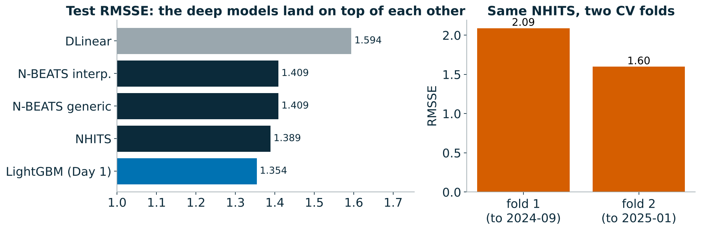

- **The deep models land on top of each other** (1.39–1.41), a little behind LightGBM (1.35). DLinear, a linear model, is clearly worse (1.59): weekly retail is not linear
- **Interpretable ≈ generic** (1.409 vs 1.409): the trend/season prior costs nothing and buys plots. Its sine waves repeat every 14 weeks or faster, so it cannot see the yearly cycle anyway
- **The test period matters more than the model**: the same NHITS scores 2.09 on the fold through Christmas and 1.60 on the next. A 0.03 gap on one window may flip on the next
- **Cost**: 19–27 s per neural fit vs about 6 s for LightGBM, on all 17,241 series

> **Takeaway:** With defaults, neural global models trail LightGBM slightly at 3–5× the fit time; no decomposition prior helped.

<!--
Reference run, CPU, 500 steps. Turn the room's attention to the fold bars: the two folds are different periods, not different seeds, so this is about how hard a window is. Lab 02 measures the real noise floor (seed to seed) and uses it to judge tuning gains.
-->

---

<!-- _class: lab dense -->

# Hyperparameter optimisation · `02` (30 min)

**Part 1: one-at-a-time sensitivity** (scored on the validation window, not the test)
- vary `input_size`, `learning_rate`, `loss`, `mlp_units` (set `RUN_ALL = True` for `scaler_type`, `max_steps`, `n_blocks`)
- refit the default with 3 seeds: the **seed spread** is the noise floor
- plot the RMSSE **spread** per parameter → the ones above the noise floor are your tuning budget

**Part 2: Optuna TPE search** with `AutoNHITS` over the parameters that mattered, fANOVA importances, refit, score. *TPE in plain words: after a few random tries, propose settings that look like the good trials and unlike the bad ones.*

| Usually worth tuning | Usually not |
|---|---|
| lookback, learning rate, steps, scaler, loss | layer width, number of blocks, activation |

> **Takeaway:** Find the one or two knobs that matter, and the noise floor, before you spend compute searching.

<!--
Ask: compare each spread to the seed spread. Anything not clearly bigger is noise. If the room is short on time, cut the GRID to input_size, learning_rate and mlp_units.
-->

---

<!-- _class: result -->

# Lab 02: what we found

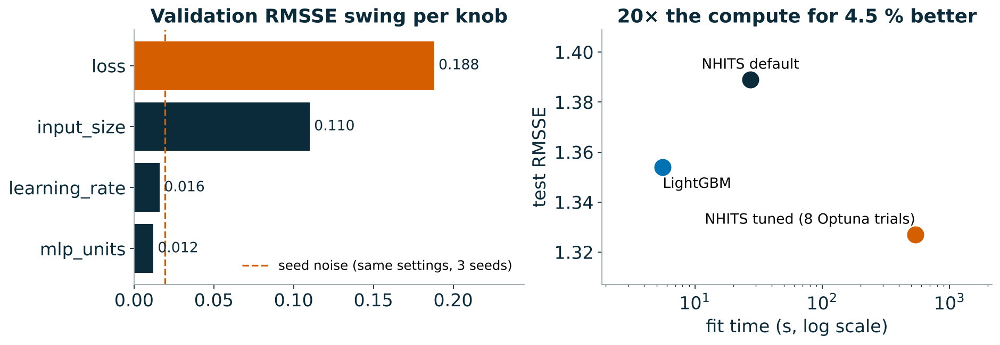

- **The noise floor**: same settings, three seeds → validation RMSSE moves by **0.02**
- **The loss is the big knob** (swing 0.19): MSE 1.80 vs MAE 1.61. MSE chases the promo spikes and overshoots every normal week
- **The lookback is the second** (swing 0.11): 56 weeks, a full year, beats 14 or 28. Width and learning rate (0.01–0.02) are inside the noise
- **Optuna**: 8 trials, 540 s, test RMSSE 1.389 → 1.327. **20× the compute for 4.5 %**, enough to pass LightGBM (1.354), mostly from the 56-week lookback

> **Takeaway:** Get the loss and the lookback right, check gains against seed noise, then stop tuning.

<!--
fANOVA on the Optuna study put 98 % of the importance on the learning rate, but that is importance within the ranges searched, from 8 trials; the one-at-a-time sweep is the more honest picture of what is worth tuning here. Lab 03 reuses the 56-week lookback with default everything else: NHITS_noexog (1.318) lands within seed noise of the tuned NHITS (1.327), so the lookback is the whole gain, and NHITSx (1.303) adds the covariates on top.
-->

---

<!-- _paginate: false -->

# Break · 15 min

---

<!-- _class: lab dense -->

# Exogenous variables and responsiveness · `03` (30 min)

| Covariate type | Example | Known in the future? |
|---|---|---|
| **future** (`futr_exog_list`) | planned price, promo flag, discount depth | yes, by plan |
| **historic** (`hist_exog_list`) | competitor price, footfall | no |
| **static** (`stat_exog_list`) | log mean sales, share of zero / promo weeks | constant |

**Response-curve checks**: shift price −25 % … +25 %, switch promos on/off, re-forecast.
- Price curve should slope **down**; promo lift should be **positive** and close to the empirical lift
- Arc elasticity per series (elasticity −2: a 10 % price cut → about 20 % more units); share of **perverse** (> 0) and **flat** responses
- LightGBM with `monotone_constraints` forces the sign of each one-step prediction (the recursive 14-week path can still bend a little); a NN has no such switch
- For a global NN, covariates must be **scale-free** (`price_index`, `discount_depth`), not raw prices

> **Takeaway:** A forecast used for pricing must move the right way, and by a plausible amount, when the price moves.

<!--
Key message: an accurate forecast that does not respond to price is useless for promo planning. Confounding: retailers cut prices when they expect high demand, so naive models can learn price↑ → sales↑.
-->

---

<!-- _class: intuition -->

# Accuracy vs responsiveness

<div class="cols">
<div>

- **Accuracy** asks: did you predict what happened?
- **Responsiveness** asks: if we changed the price, would you predict the right thing?
- A model can score well and still answer "what if?" wrongly: it may have learned **when** promos happen, not **what they do**
- **Confounding**: retailers discount when they expect demand to be high, so the data alone can suggest "cheaper → fewer sales"

</div>
<div>

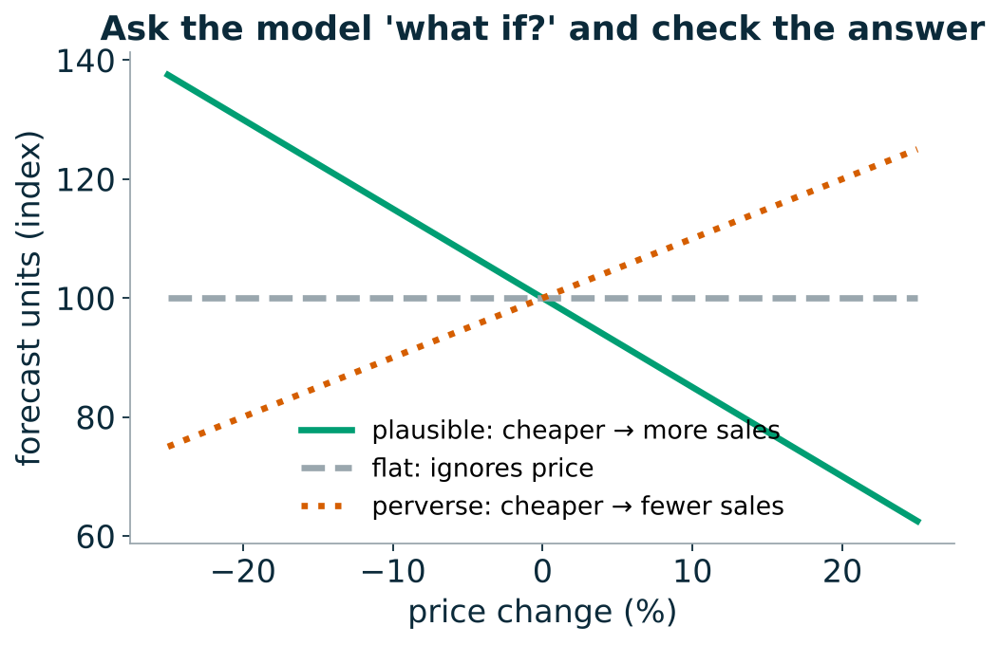

</div>
</div>

> **Takeaway:** Score accuracy on the test window; check responsiveness with what-if scenarios.

<!--
Analogy: ice-cream sales and sunburn rise together; banning ice cream does not prevent sunburn. The model sees promotions and high sales together but cannot tell which way the arrow points without a check like the response curves in this lab.
-->

---

<!-- _class: result -->

# Lab 03: what we found

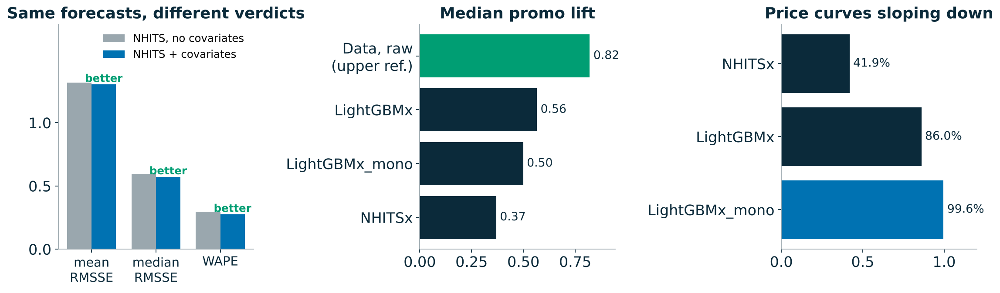

- **LightGBM needs them**: without covariates it drops from 1.37 to 1.52. Lags alone cannot know next week is a promo
- **NHITS: small on the mean, clear elsewhere.** Mean RMSSE 1.32 → 1.30, better on 56 % of series, median 0.60 → 0.57, WAPE 0.29 → 0.28. On intermittent items the covariates are noise and hold the mean back
- **Direction mostly right**: about 2 % of NHITSx's price curves and 0.1 % of LightGBM's point the wrong way; the monotone constraint makes 99.6 % of LightGBM curves slope down
- **Size timid**: models predict a median promo lift of **+37 % to +57 %**; the raw data says +82 % (an upper bound, as promos are timed for good weeks)

> **Takeaway:** Judge covariates on more than one summary, and check the size of the response, not just its sign.

<!--
Headline for the room: NHITSx has the best mean, median and WAPE of the lab and the most timid promo response (+37 %). Accuracy and responsiveness are different questions. The promo scenario switches on the flag together with the item's usual discount, so it compares like with like.
-->

---

<!-- _class: summary -->

# Summary: train, tune, add covariates

- **Defaults**: NHITS and N-BEATS trail Day 1's LightGBM slightly (1.39–1.41 vs 1.35) at 3–5× the fit time; decomposition priors did not help
- **Tuning**: the loss and the lookback are the knobs that beat the seed noise. Optuna bought 4.5 % for 20× the compute
- **Covariates**: LightGBM cannot do without them (1.37 → 1.52). NHITS gets better on most items with them, but worse on intermittent ones, which keeps the mean gain small
- **Responsiveness**: price curves point the right way; promo lifts are timid (+37 % to +57 %)
- Always look at **more than one summary**: mean, median, WAPE and share of series improved can disagree

<!--
Before the foundation-model block: ask the room which of these numbers they would show a category manager.
-->

---

<!-- _class: dense -->

# Foundation models for time series

Pretrained on large, diverse corpora; forecast new series **zero-shot** from the context window.

| Model | From | Idea | Covariates |
|---|---|---|---|
| **Chronos** / Chronos-Bolt | Amazon | T5 on scaled, quantised values / patches | no |
| **Chronos-2** | Amazon | encoder with group attention across series and covariates | past + future, in-context |
| **TimesFM** | Google | decoder-only, patched input | limited (via regression) |
| **Moirai** | Salesforce | any-variate masked encoder | yes |
| **TabPFN-TS** | Prior Labs | tabular prior-fitted network on time features | yes, as columns |

`timecopilot` wraps these (and `statsforecast` / `neuralforecast` models) behind one `forecast(df, h, freq)` API.

> **Takeaway:** Pretrained on millions of series: a strong zero-shot baseline. Only some models use covariates.

<!--
20-minute segment. Stress the pattern: patching/tokenising + transformer + huge pretraining corpus + mean/quantile heads. Chronos-2 and TabPFN-TS are the ones that use covariates, which matters for this retail data.
-->

---

<!-- _class: intuition -->

# How a foundation model reads a series

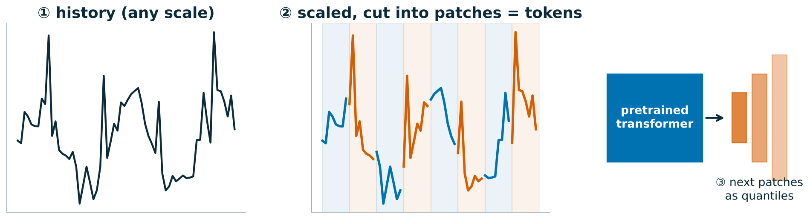

- **Scale** the history so every series looks alike, **chop** it into short patches (the "words"), and let a transformer read them like a sentence
- It predicts the next patches as **quantiles**, from patterns learned on millions of other series
- Chronos-2 also reads **covariates** and **related series** in the same pass (group attention)

> **Takeaway:** Same recipe as a language model: tokens, a transformer, and a huge pretraining corpus.

<!--
The analogy holds well: patching is tokenisation, the quantile head is the "next token" distribution, and zero-shot is prompting. Fine-tuning is the same as fine-tuning an LLM, often with LoRA.
-->

---

<!-- _class: intuition -->

# Foundation models: the well-travelled forecaster

<div class="cols">
<div>

**Zero-shot**: a consultant who has seen millions of series from every industry, but never your shop. You show them the last 93 weeks and ask for the next 14

**Fine-tuned**: the same consultant after a week of induction on your data. Better on your quirks, but you now pay for training and can overfit

</div>
<div>

**Covariates in context**: Chronos-2 reads your promo calendar like notes in the margin, without retraining

**What to look for in lab 04**: is zero-shot within a few percent of our best model? If so, it is a strong baseline for almost no effort. Fine-tune only if validation says it clearly helps

</div>
</div>

> **Takeaway:** Try zero-shot first; fine-tune only when validation shows a clear gain worth the GPU time.

<!--
Lab 04 reference run (all 17,241 series, 4-core CPU, 1 h 55 min): zero-shot Chronos-2 with covariates 1.294 on test, fine-tuned 1.282, NHITSx 1.303. Ask the room to fill in the decision table from validation before showing these.
-->

---

# Zero-shot vs fine-tuned

<div class="cols">
<div>

**Zero-shot**
- No training: minutes to first forecast
- Strong on regular, seasonal series
- Knows nothing about *your* promo calendar unless the model takes covariates
- Benchmark caveat: public test sets may be in the pretraining data

</div>
<div>

**Fine-tuned** (full or LoRA)
- Adapts to your domain: intermittency, promo spikes
- Needs enough series, a validation window and GPU time
- Risk: overfitting / forgetting with little data
- You now own a training pipeline again

</div>
</div>

**Context length**: Chronos-2 and TimesFM 2.5 accept thousands of points; our weekly series have ≤ 93 training weeks, so context is *not* the bottleneck here; covariates are.

> **Takeaway:** With ≤ 93 weeks of history, a foundation model's value is its prior, not its context length.

<!--
Ask the room: with 93 weeks of history, what does a model with 8k context buy you? (Nothing; the value is the prior learned across millions of series.)
-->

---

# Inference cost

| | Params | Hardware | Relative cost per 1k series |
|---|---|---|---|
| SeasonalNaive / ETS | — | CPU | ≈ free |
| LightGBM | ~MB | CPU | low |
| NHITS | ~1–5 M | CPU / GPU | low (after training) |
| Chronos-Bolt (small/base) | 48–205 M | CPU ok, GPU better | medium |
| Chronos-2 | ~120 M | GPU preferred | medium–high |
| TabPFN-TS | ~10 M; one forward pass per series, its history as context | GPU preferred | high |

Rule: measure **seconds per 1,000 series** in lab `04` and put it next to RMSSE.

> **Takeaway:** Put seconds per 1,000 series next to accuracy: foundation models cost more per forecast.

<!--
Numbers are orders of magnitude; the lab measures the real ones on your hardware. TabPFN-TS does no training: it runs a forward pass per series with that series' own feature table as context, so its cost grows fastest with the number of series.
-->

---

<!-- _class: lab -->

# Foundation models: tune or not? · `04` (30 min)

1. **Zero-shot** via `timecopilot`: Chronos-2 (with and without covariates), TabPFN-TS on a subset
2. **Fine-tune** Chronos-2 on the training windows; compare on the **validation** window first
3. Measure **seconds per 1,000 series**
4. Fill in the decision table:

| | Accuracy gain vs tuned NHITS / LightGBM | Cost | Decision |
|---|---|---|---|
| zero-shot | ? | ? | |
| fine-tuned | ? | ? | |

> **Takeaway:** Decide on the validation window, run the test once, and write the decision down.

<!--
Downloads: Chronos-2 weights come from Hugging Face; make sure the room downloaded them before the break (the notebook's first cell does it). On CPU, use the 500-series subset flag in the notebook.
-->

---

<!-- _class: summary -->

# Summary: foundation models

- A foundation model is a **prior learned from millions of series**; zero-shot means "use the prior, no training"
- **Covariates** decide whether it can see your promotions: Chronos-2 and TabPFN-TS can, older models cannot
- **Fine-tuning** adapts the prior to your data, at the price of a training pipeline and GPU time
- With short weekly histories, **context length** is not the bottleneck; information is
- Decide on **validation**, and put **seconds per 1,000 series** next to the accuracy gain

<!--
Fill in the decision table with the room's results, then show the reference run on the next slide.
-->

---

<!-- _class: result -->

# Lab 04: what we found

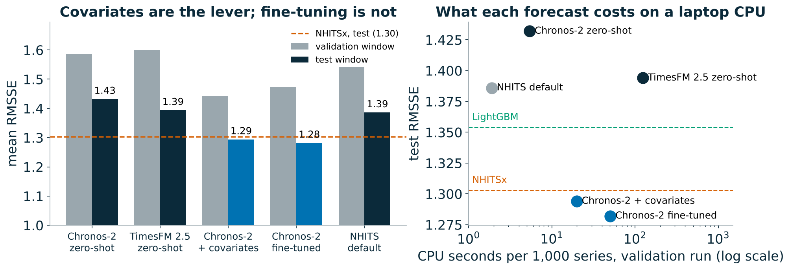

- **Zero-shot is already a baseline to beat**: Chronos-2 and TimesFM 2.5 agree (1.59 and 1.60 on validation), level with a default NHITS, with no training
- **Covariates in context are the lever**: 1.59 → 1.44 on validation, mostly on erratic, promo-driven items. On test, 1.29 beats NHITSx (1.30) and LightGBM (1.35), median 0.51 vs 0.57
- **Fine-tuning fails the validation test** (1.47 vs 1.44) and gains 0.01 on test, half the seed noise, for 10 more CPU minutes

> **Takeaway:** Chronos-2 with covariates was the best single model of the day; fine-tuning added 0.01, inside the noise, so decide with validation, not hope.

<!--
Cost on a 4-core CPU per 1,000 series (validation run): Chronos-2 5 s zero-shot, 20 s with covariates, about 50 s fine-tuned (150 LoRA steps); TimesFM 120 s; NHITS trains and forecasts in about 2 s. Intermittent and lumpy items barely move with any model. The ensembles in Lab 07 now include the foundation models.
-->

---

<!-- _class: lab -->

# Hierarchy and coherence · `05` (20 min)

Total → departments → classes → subclasses → items (from `hierarchy.csv`). Independent forecasts do not add up.

$\tilde{y} = S\,G\,\hat{y}$ — **S** sums bottom to all levels, **G** maps base forecasts to the bottom level.

| Method | G uses | Good at |
|---|---|---|
| BottomUp | items only | items |
| TopDown / MiddleOut | the top / a middle level + proportions | top / middle |
| MinTrace `ols` · `wls_struct` · `wls_var` | all levels; `ols` weighs every node equally, `wls_struct` by how many items sit below it, `wls_var` by each node's own past error variance (`mint_shrink` adds the covariances: too big for 19,000 nodes) | depends on the weights (see results) |

**Discuss**: which level does the business consume, and which method wins there?

> **Takeaway:** Reconciliation makes every level add up; the method decides which level's forecast you trust.

<!--
Lab builds the hierarchy from hierarchy.csv with hierarchicalforecast.aggregate, AutoETS base forecasts, six reconcilers, a coherence check (MiddleOut fails it with hierarchicalforecast 1.5.3 and is dropped) and accuracy by level.
-->

---

<!-- _class: intuition -->

# Coherence: the numbers must add up

<div class="cols">
<div>

- Forecast every level separately and the items will not add up to the department, like a budget whose line items disagree with its total
- **BottomUp** trusts the items, **TopDown** trusts the total and splits it by history
- **MinTrace** trusts each level in proportion to how reliable it has been, and moves each number as little as possible

</div>
<div>

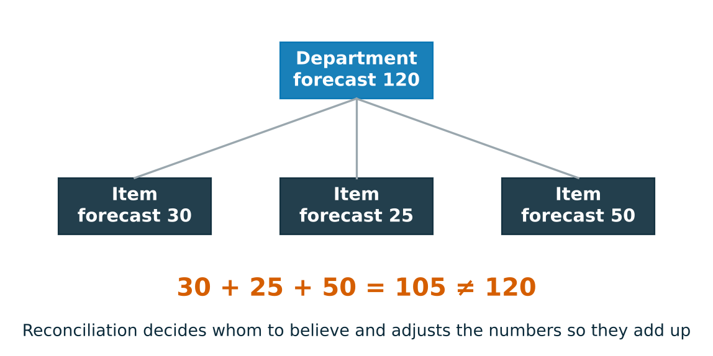

</div>
</div>

> **Takeaway:** Coherent forecasts let buyers and finance plan with the same numbers.

<!--
Ask: who in the business reads which level? Buyers read items, finance reads departments and the total. Coherence matters because those people talk to each other.
-->

---

<!-- _class: result -->

# Lab 05: what we found

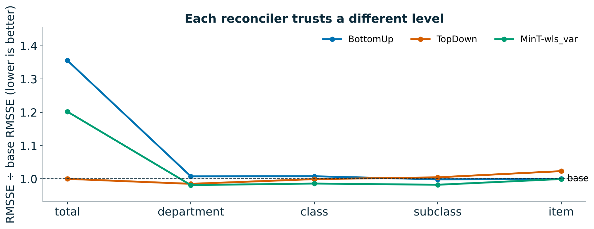

- **BottomUp**: items unchanged, but the total is 36 % worse: small item biases add up across 17,000 items
- **TopDown**: the total is untouched, items are 2 % worse: fixed proportions miss item-level promotions
- **MinT-wls_var**: about 2 % better than the base in the middle levels, coherent, and tied with the base at the items (1.400 vs 1.402); it pays 20 % on the store total. Not shown: **MinT-ols** is 4–24× worse below the total, because it weighs a 600-unit item like a department selling millions
- **MiddleOut** failed the coherence check in this library version and was dropped: always run the check

> **Takeaway:** MinT with per-node variances gives coherence almost for free; the weights are what make it work.

<!--
Ratios are relative to the incoherent base forecasts (lower is better), scaled by the 1-step naive error. Reconciliation is cheap and rarely hurts, but the weights matter: wls_struct, which only counts items under a node, is up to 2.6x worse at the item level.
-->

---

# Uncertainty: what are we scoring?

- A forecast for ordering stock is a **distribution**, not a number: quantiles, intervals, samples
- **Calibration**: 80 % intervals contain the truth 80 % of the time
- **Sharpness**: among calibrated forecasts, narrower is better
- **Proper scoring rule**: the expected score is optimised only by reporting your true belief

| Score | For | Formula (per observation) |
|---|---|---|
| Pinball / quantile loss | a quantile q_τ | max(τ(y−q), (τ−1)(y−q)) |
| CRPS | full distribution | ∫ pinball over τ ≈ 2 · mean pinball over quantiles |
| Interval (Winkler) score | [l, u] at 1−α | (u−l) + (2/α)(l−y)₊ + (2/α)(y−u)₊ |

Scale them per series (like RMSSE) before averaging across series.

> **Takeaway:** Judge intervals by calibration first, then sharpness, with a proper score.

<!--
20-minute segment with notebook 06 as the live demo. Coverage alone is not a score: [0, ∞) has 100 % coverage.
-->

---

<!-- _class: intuition -->

# CRPS: one score for a whole distribution

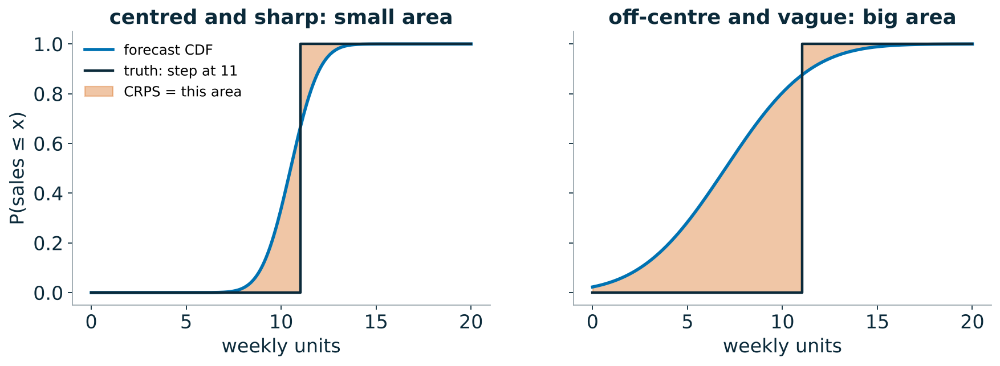

- Draw the forecast as a **CDF** (how likely "at most x" is) and the truth as a **step** at the actual value
- **CRPS = the area between them**: small when the forecast is both centred and confident, large when it is off or vague
- For a single number instead of a distribution, CRPS equals the **absolute error**: it is MAE generalised to distributions

> **Takeaway:** CRPS rewards forecasts that are centred and sharp, in the units of the data.

<!--
In notebook 06 we approximate CRPS from five quantiles with the average pinball loss, times two, and scale it per series like RMSSE.
-->

---

<!-- _class: intuition -->

# Calibration, sharpness and honest scores

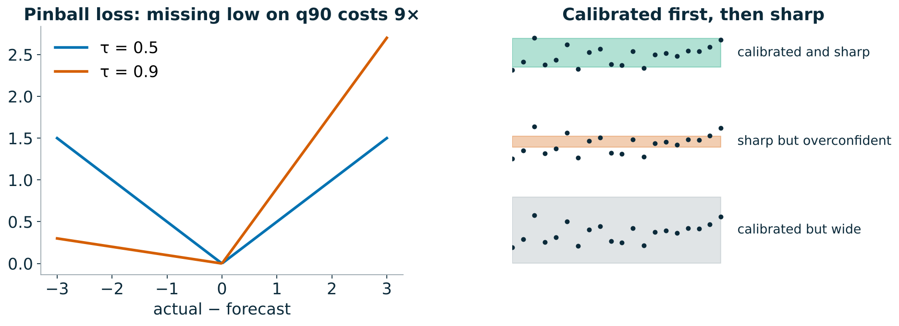

- A weather forecaster who says "30 % chance of rain" should see rain on about 30 % of those days: that is **calibration**
- "Between 0 and 100 mm" is always right and useless: among calibrated forecasts, prefer the **sharpest**
- A **proper** score rewards honesty: you cannot improve your expected score by reporting anything other than what you believe

> **Takeaway:** A good interval covers what it promises and is as narrow as possible.

<!--
The pinball loss on the left is the whole idea of quantile forecasting: for the 90 % quantile, being 1 unit too low costs 9 times as much as being 1 unit too high, so the best answer sits high.
-->

---

<!-- _class: dense -->

# Conformal prediction

**Split conformal** around any point model:
1. Hold out calibration windows (rolling origins in the training data)
2. Conformity scores = |y − ŷ| on those windows, per horizon step
3. Interval = ŷ ± the (1−α) quantile of the scores

- Guarantee: **marginal** coverage ≥ 1−α under exchangeability, in finite samples, **if** there are enough calibration scores: at least ⌈(n+1)(1−α)⌉ ≤ n, i.e. 19 for a 95 % interval
- Not guaranteed: coverage **per series**, per promo week, or under drift
- Extensions: **pooling** scaled scores across series, **CQR** (conformalise quantile-model intervals), **adaptive** CP for drift, per-segment calibration

In the stack: `PredictionIntervals` (`mlforecast`), `ConformalIntervals` (`statsforecast`); quantile losses (`MQLoss`) in `neuralforecast`.

> **Takeaway:** Conformal turns past errors into intervals for any model, given enough past errors and a stable world.

<!--
In the demo the library conformal methods calibrate each series on only 3 windows, which caps their coverage near 75 %; pooling scaled errors across series fixes it. Then plot coverage by velocity class: pooled intervals can over-cover some classes and under-cover others.
-->

---

<!-- _class: intuition -->

# Conformal: be as wrong as you were before

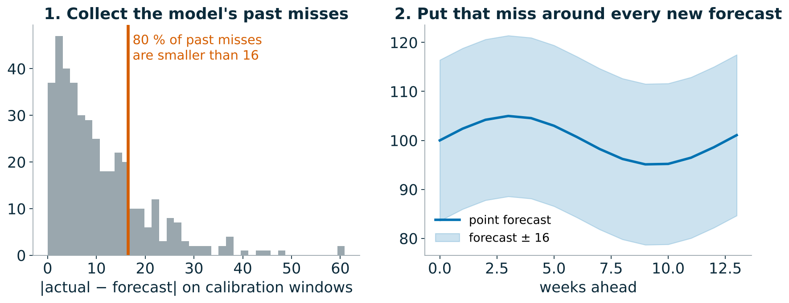

- Look at how wrong the model has been on recent, held-out weeks, and promise **that much** around every new forecast
- It works for **any** model and needs no distribution assumptions
- The promise holds only if the future looks like the past you calibrated on

> **Takeaway:** Same idea, any model: the width comes from how wrong you have been.

<!--
The promise also needs enough past errors: from 3 windows per series, a 95 % interval is just the largest of 3 errors. The next slide shows what that does.
-->

---

<!-- _class: result -->

# Demo 06: what we found

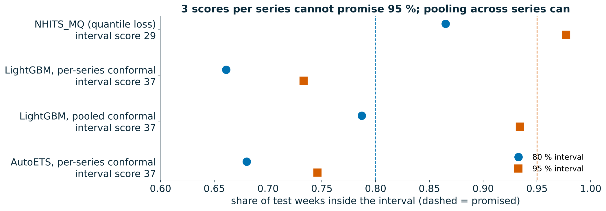

- **NHITS with quantile loss** over-covers (87 % for 80 %, 98 % for 95 %) and still has by far the best scores (CRPS 2.7 vs about 3.7): it learned **per-item, per-week widths**
- **Per-series conformal** under-covers (66–68 % for 80 %, 73–75 % for 95 %). The cause is arithmetic: 3 windows give 3 errors per series, and a new error beats the largest of 3 one time in 4
- **Pooled conformal** (scale-free errors pooled across series) keeps the promise (79 %, 93 %) but scores no better: same relative width for every item
- Fixes that add shape: calibrate **per class**, or conformalise the quantile model (**CQR**)

> **Takeaway:** A conformal promise needs enough past errors, and honest width is not yet useful width.

<!--
Good moment to repeat: the conformal guarantee is marginal and needs at least ceil((n+1)(1-alpha)) scores. With n = 3 it cannot deliver 80 % or 95 %. Pooling gives thousands of scores, so the coverage comes back.
-->

---

<!-- _class: summary -->

# Summary: coherence and uncertainty

- **Coherence**: MinT-wls_var makes every level add up and costs nothing at the items (1.400 vs 1.402); BottomUp loses at the top, TopDown at the bottom
- **Weights matter**: MinT-ols, which weighs every node equally, is 4–24× worse below the total. At 19,334 nodes only the sparse reconcilers fit in memory
- **Intervals**: judge calibration first, then sharpness, with a proper score (interval score, CRPS)
- **Conformal** keeps its promise only with enough calibration errors: 3 per series cap coverage near 75 %; pooling fixes the coverage
- The **quantile-loss NHITS** gave the best intervals: widths that follow each item and week

<!--
One line per idea; then move on to model selection.
-->

---

<!-- _class: lab -->

# Model selection and ensembling · `07` (20 min)

- **Win rate**: share of series where A beats B (ties count ½)
- **Bradley–Terry**: P(A beats B) = s_A / (s_A + s_B), fitted on all series-level duels
- **Elo**: replay series as matches, update `r ← r + K(s − E)`, average over shuffles
- **By volume** (velocity class A–J) and **shape** (smooth / erratic / intermittent / lumpy, feature clusters)
- **Ensembles**: mean, median, top-3, best-per-class, chosen on **half the series**, scored on the other half

> **Takeaway:** Look beyond the mean: who wins most often, where, and does averaging help?

<!--
Point to watch: rating order vs mean-RMSSE order. A model can win most duels by a little and still lose on the mean because of a few large misses (here: the intermittent items).
-->

---

<!-- _class: intuition -->

# Ratings: a league table for models

<div class="cols">
<div>

- Treat every series as a **match** between two models: whoever has the lower RMSSE wins
- **Win rate**: how often A beats B. It ignores by how much, so one disaster cannot dominate
- **Elo / Bradley–Terry** turn all the matches into one rating, like chess: **+100 points ≈ 64 %** chance to win a series
- **Ensembles**: a panel of forecasters whose mistakes partly cancel

</div>
<div>

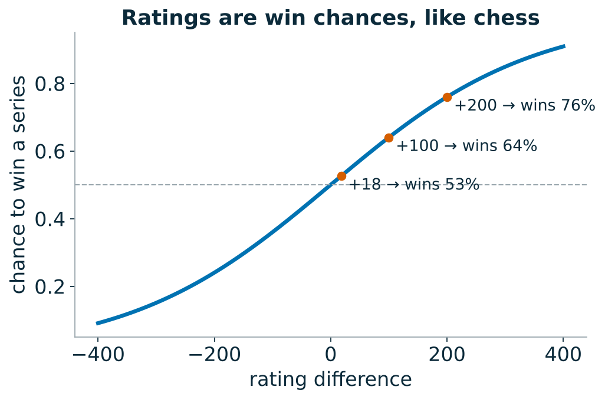

</div>
</div>

> **Takeaway:** Win rates show who usually wins; mean RMSSE shows who avoids disasters. Read both.

<!--
Mean RMSSE answers "who is best on average, including disasters"; ratings answer "who usually wins". Both are legitimate; they disagree when a model is consistently a little better but occasionally very wrong.
-->

---

<!-- _class: intuition -->

# Demand types: smooth, erratic, intermittent, lumpy

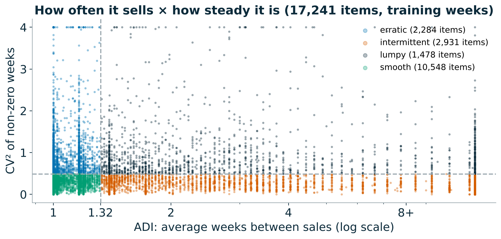

- **How often** does it sell? ADI = average weeks between sales. **How steady** is a sale when it happens? CV² of the non-zero weeks
- Cut-offs ADI 1.32 and CV² 0.49 (Syntetos–Boylan) give four types; each favours different models
- Lab 07 slices every result by these types: averages over "all items" hide that the hard items are a minority

> **Takeaway:** Two numbers per item, how often and how steady, explain most of where models win and lose.

<!--
These are computed from the training weeks in bootcamp.series_info. (The precomputed features file has standardised values, so the lab no longer uses it for this.)
-->

---

<!-- _class: result -->

# Lab 07: what we found

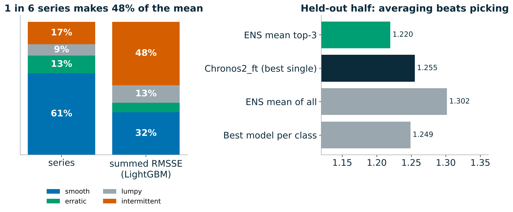

- **Chronos-2 with covariates leads**: fine-tuned has the lowest mean, zero-shot wins the most duels (68 %), then NHITSx; LightGBM is 6th on the mean but 4th in duels
- **Intermittent items, 17 % of series, make 46–49 % of the summed RMSSE**; covariates hurt there (the NHITS models without them win), so the mean is mostly a contest about the hardest items
- On the **held-out half**, the average of the top 3 (Chronos-2 ×2 + NHITSx) beats every single model by about 3 % (1.220 vs 1.255 for Chronos2_ft)
- Picking the best model **per class** lands in between (1.249): **averaging is the safer default**

> **Takeaway:** No model wins everywhere; averaging a few good models from different families is the safest pick.

<!--
On the leaderboard the top-3 average scores 1.164, but half the series helped choose it, so that number is optimistic. Quote the held-out comparison: 1.220 vs 1.255 for the best single model (Chronos2_ft) and 1.330 for Day 1's LightGBM on the same half. Without the foundation models the gain was about 1 % (three NHITS variants).
-->

---

# Final standings

Run the last cells of `07`; the chart is saved to `results/day2/final_standings.png`

**Decision framework to take home**
1. Baselines first
2. Global before deep: the tuned GBDT is the bar
3. Tune the few things that matter, then stop
4. Check responsiveness before accuracy when the forecast drives prices or promos
5. Foundation models: strong zero-shot baseline; fine-tune when validation says so and the budget allows
6. Reconcile when several levels are consumed
7. Report win rates and segments, ensemble when nobody dominates

> **Takeaway:** Baselines first, global before deep, tune little, check responsiveness, reconcile, then ensemble.

<!--
5 minutes. Announce the top three, then go back to the open questions from the recap slide and answer them with today's numbers.
-->

---

<!-- _class: result -->

# This morning's questions, answered

| Question from the recap | What today's numbers say |
|---|---|
| Is the GBDT strong because it is **global** or because of **covariates**? | **Covariates**: LightGBM without them falls to 1.52, no better than Naive. A neural net needs them less: NHITS without covariates (1.32) already beats LightGBM (1.35) |
| Can a neural net learn the hand-built features? | **Mostly yes**, from the raw window; covariates still help it on most series, just not on intermittent ones |
| What does it cost? | 19–27 s per neural fit vs about 6 s; tuning 540 s for 4.5 %; zero-shot Chronos-2 about 6 min on a CPU |
| Best single model? | **Chronos-2 with covariates**: 1.28 fine-tuned, 1.29 zero-shot (the gap is noise) vs 1.30 for NHITSx and 1.35 for LightGBM |
| Does it **respond to price** the right way? | **Direction yes, size timid**: promo lift +37 % to +57 % vs +82 % raw in the data (an upper bound) |
| Best of the day? | The **average of the top 3**: on the held-out half 1.22 vs 1.26 for the best single model (Chronos2_ft) and 1.33 for Day 1's LightGBM |


<!--
Close the loop explicitly: go back to slide 4's open questions and read this table out. Then the decision framework on the previous slide is the take-home.
-->
